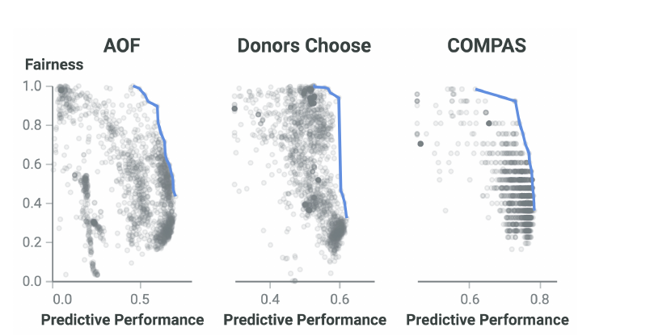

  
  
  
  
  
  
  

<h1 align="center">:cyclone: CSC510: Software Engineering  NC State, Fall '26</h1>

# Fairness

These notes expand [N13 §3](n13.md). Same style: short sentences,
one meaning per term.

## Terms used in these notes

| Term | Meaning in these notes |
|---|---|
| protected attribute | A feature that records social grouping: sex, race, age, nationality. Also called a sensitive attribute. A model is unfair when its predictions differ just because of that grouping. |
| favorable outcome | The prediction people want: loan approved, resume shortlisted, bail granted. Written ŷ = 1. |
| SPD | Statistical parity difference. The gap between two groups in their rate of favorable outcomes. Defined in section 2. |
| worst-SPD | The largest SPD over all protected attributes. A model is only as fair as its least fair attribute. |
| fairness bug | A disparity shipped inside a software system. A system failure, filed and fixed like other failures. |
| mitigator | An algorithm that repairs fairness bugs by changing the data, the learner, or the predictions. |
| model multiplicity | One data set yields many models with similar accuracy and very different fairness. |

---

## 1. Three invoices

Software decides who gets a loan, a job interview, bail, or
medical care. When the software favors one group over another,
people get hurt and organizations pay. Three cases, each with its
bill:

| Case | What the software did | The bill |
|---|---|---|
| iTutorGroup (2023) | Hiring software auto-rejected older applicants. The EEOC's first AI-discrimination suit. | $365,000 |
| US housing | Meta's ad algorithms skewed housing ads by race and gender (civil penalty). SafeRent's tenant screening penalized Black and Hispanic applicants. | $2.3 million (SafeRent) |
| Dutch childcare benefits | The tax authority used dual nationality as a fraud indicator. Thousands of families were wrongly pursued. | €2.75 million, plus €3.7 million for an unlawful blacklist. The scandal brought down the Dutch cabinet in January 2021. |

Read the table as one sentence: a fairness bug is a system
failure, and the failure comes with an invoice, a regulator, and
sometimes a fallen government.

This makes fairness a software engineering problem three times
over:

- The models ship inside software systems, so their disparities
  are system failures. The literature calls them fairness bugs.
- Fairness is a non-functional requirement: a property a deployed
  system must satisfy, measured by tests against held-out data.
- The tools are SE tools: testing, search, baselines, and
  selection.

That last point started in 2017. Galhotra, Brun, and Meliou's
Themis tool flipped the protected attribute of an input and
checked whether the output changed. One metamorphic test, and
fairness became a property that SE could test, measure, and fix.

---

## 2. Measure: SPD

SPD asks a simple question: **does the model say "yes" more often
to one group than to another?**

A protected attribute $a$ (say, sex or race) splits the rows into
two groups, $g_{a,1}$ and $g_{a,2}$. Then

$$SPD_a = \big| P(\hat{y}=1 \mid g_{a,1}) - P(\hat{y}=1 \mid g_{a,2}) \big|$$

- Each term is the rate at which one group receives the favorable
  outcome.
- $SPD_a = 0$: both groups get the favorable outcome at the same
  rate.
- $SPD_a = 1$: one group always gets it; the other never does.

A worked example. A loan model approves 40 percent of male
applicants and 25 percent of female applicants. SPD on sex is
|0.40 − 0.25| = 0.15. No accuracy number appears anywhere in that
calculation. A model can be highly accurate and badly unfair at
the same time; the two measures move independently.

Data sets carry several protected attributes, so report the worst
case:

$$W = worst\text{-}SPD = \max_a SPD_a$$

One number in [0, 1], lower is better, and a model is only as
fair as its least fair attribute.

Notes on the metric zoo:

- N13 §3.1 defined EOD and AOD, which compare error rates between
  groups rather than approval rates. SPD is the most widely used
  group measure in SE research, and many other metrics correlate
  with it.
- The definitions can conflict. In general they cannot all hold
  at once, so each project must choose its criteria, in writing,
  before training. That choice is a requirements decision, not a
  tuning decision.
- Fairness alone is easy to fake: a model that approves nobody
  has SPD = 0. Useful models must score on fairness and
  performance together. One such joint measure is distance to the
  ideal point (maximum recall and precision, minimum false alarms
  and disparity); lower is better.

---

## 3. Fix: the mitigator catalog

SE researchers built many mitigators. IBM's AIF360 toolkit sorts
them into a pipeline:

*(1. pre-processing → 2. in-processing → 3. post-processing) ⇒ model*

Each published method bets on one root cause and repairs it:

- Skewed training data → fix the data: reweigh or resample
  under-represented group-label combinations (Reweighing,
  Fair-SMOTE, FairBalance).
- Biased features → transform them: remove the part of each
  feature explained by protected attributes (LTDD).
- A learner blind to fairness → constrain it: add fairness terms
  to the loss (ExpGrad); make tree splits group-aware (GroupCART).
- A poor configuration → search for a better one (FairRS, FairRF).
- Reliance on protected attributes → counter it: blend a model
  with its counterfactual twin (MirrorFair); ensemble over
  mutated protected attributes (FairHOME).
- A model trading fairness for accuracy → combine models: one
  tuned for each (MAAT).
- Bias near the decision boundary → repair decisions: relabel
  uncertain predictions in favor of the unprivileged group
  (Reject-Option).

Two cautions from the comparison literature:

- A mitigator can "work" by quietly trading accuracy away. Hort
  et al.'s Fairea baseline detects that trade.
- Chen et al. applied that baseline to 17 methods: no method
  dominates. There is no silver bullet to install and forget.

---

## 4. Or: find, do not build

A 2026 study (under review; this course's research group) asked a
simpler question: how much of that mitigation machinery is
necessary?

The observation behind the question is model multiplicity. Cruz
et al. generated about 10,000 models per data set by varying the
hyperparameters of five ordinary learners:

Each gray dot is one trained model; the blue line is the
fairness-performance Pareto frontier. (From Cruz et al., ICDM
2021. Data: AOF, account-opening fraud; Donors Choose, project
funding; COMPAS, recidivism.)

Read the figure as one sentence: pick any x value, then look up.
At any fixed performance level, fairness spans most of the
y axis, so among similarly good models, fairer ones already
exist.

So the study's system, BLURT, engineers nothing:

- Generate many small cheap models, with no fairness objective
  anywhere: one base decision tree, then many variants by
  shallow-copying subsets of it, each variant costing
  microseconds.
- Select the one with the best validation fairness-performance
  trade-off.

Results, on 13 data sets against 14 published mitigators
(2012-2026):

- BLURT's selected models were top-ranked on more data sets than
  any mitigator studied.
- It ran 5 to 24 times faster than the state of the art.
- Standard hyperparameter search with the same time budget
  produced less-fair models.
- The selection step, not the generator, carried most of the
  gain: ordinary learners (random forests, decision trees,
  logistic regression) did nearly as well once their models were
  selected the same way.

Stated limits: binary classification, tabular data, 13 data sets,
four fairness criteria. On disparity alone, specialized
mitigators can still win.

The lesson, in the study's own words: the fair model you need may
be the one you trained and accidentally threw away. Fair models
often need not be built. They may be already there, waiting to be
found.

This should sound familiar. It is the wave-3 result of
[N12 §2.1](n12.md) wearing a fairness hat: before you buy complex
machinery, test a cheap baseline that searches what you already
have.

---

## 5. Rules for your project

- Name the protected attributes in the requirements document.
  If the data has sex, race, age, or nationality columns (or
  proxies for them, like zip code), say so and say what the
  system must guarantee.
- Choose the fairness metric and a threshold before training.
  SPD is the common default; write down why yours fits.
- Put the metric in the test suite. Per-group rates, per release,
  next to the accuracy numbers. A fairness regression is a
  failing test.
- When a model is unfair, try selection first: train many cheap
  variants, measure, pick. Reach for heavier mitigators only when
  selection is not enough, and check them against a Fairea-style
  baseline.
- Keep the logs. The Dutch families could not see why the system
  flagged them. Your audit trail is the difference between a
  fixable bug and a scandal.

---

## Sources

**The three invoices (section 1).** EEOC v. iTutorGroup,
settlement announced August 2023
([EEOC press release](https://www.eeoc.gov/newsroom/itutorgroup-pay-365000-settle-eeoc-discriminatory-hiring-suit)).
US v. Meta (housing ads), settlement 2022
([DOJ press release](https://www.justice.gov/opa/pr/justice-department-secures-groundbreaking-settlement-agreement-meta-platforms-formerly-known));
Louis et al. v. SafeRent, $2.3M settlement approved 2024.
The Dutch childcare benefits scandal: Dutch Data Protection
Authority fines of €2.75M (2021) and €3.7M (2022); the Rutte
cabinet resigned January 2021. Press and agency sources, not peer
reviewed.

**Fairness as a testable property (section 1).** Galhotra, Brun,
Meliou, *Fairness testing: testing software for discrimination*,
FSE 2017 (distinguished paper). Chakraborty, Majumder, Menzies,
*Bias in machine learning software: why? how? what to do?*, FSE
2021 (distinguished paper). Chakraborty, Majumder, Yu, Menzies,
[*Fairway: a way to build fair ML software*](https://arxiv.org/pdf/2003.10354.pdf),
FSE 2020.

**Metrics and mitigators (sections 2, 3).** Bellamy et al., *AI
Fairness 360*, 2018
([AIF360](https://krvarshney.github.io/pubs/BellamyDHHHKLMMNRRSSSVZ_sm2019.pdf)).
Hort, Zhang, Sarro, Harman, *Fairea: a model behaviour mutation
approach to benchmarking bias mitigation methods*, FSE 2021.
Chen, Zhang, Sarro, Harman, *A comprehensive empirical study of
bias mitigation methods for machine learning classifiers*, TOSEM
2023. Hort et al., *Bias mitigation for machine learning
classifiers: a comprehensive survey*, 2023.

**Multiplicity and selection (section 4).** Cruz, Saleiro,
Belém, Soares, Bizarro,
[*Promoting fairness through hyperparameter optimization*](https://arxiv.org/abs/2103.12715),
ICDM 2021 (figure 1 is reproduced above): fairness varies widely
at fixed performance. *How much of fairness mitigation is
necessary?* — under review, 2026; code, data, and analyses at
[tinyurl.com/blurtrepro](https://tinyurl.com/blurtrepro). An
unrefereed preprint from this course's research group. State both
facts when you cite it.
