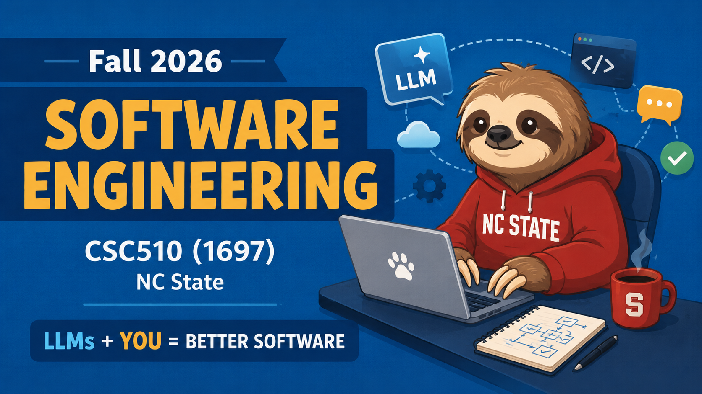

<p align="center">
  <a href="https://github.com/txt/se26f/blob/main/README.md"></a>
  <a href="https://github.com/txt/se26f/blob/main/docs/lect/policies.md"></a>
  <a href="#"></a>
  <a href="https://ncsu.hosted.panopto.com/Panopto/Pages/Sessions/List.aspx#folderID=d778d356-94d2-48b1-a25f-b4a401818991"></a>
  <a href="https://moodle-courses2527.wolfware.ncsu.edu/course/view.php?id=12082&bp=s"></a>
  <a href="https://discord.gg/zrsW8F2V9"></a>
  <a href="https://github.com/txt/se26f/blob/main/LICENSE.md"></a></p>
<h1 align="center">:cyclone: CSC510: Software Engineering <br>NC State, Fall '26</h1>



# N12: AI for SE (Nov 04)

These notes use Simplified Technical English. Sentences are short.
Each term has one meaning. The style is plain, because the content
is not.

## Terms used in these notes

| Term | Meaning in these notes |
|---|---|
| LLM | A large language model. One software component. Nothing more. |
| agentic loop | A program that calls an LLM many times, gives it tools, and decides when to stop. |
| RAG | Retrieval-augmented generation. The system finds text, then puts that text in the prompt. |
| compiled wiki | A set of linked pages that an LLM writes from immutable sources. |
| evaluator | The part of a loop that tests the work and tries to show that the work is wrong. |
| contract | A list of testable assertions that defines "done". |
| job | One of five tasks: decide, classify, predict, configure, optimize. |
| M0 | The required business-level evaluation milestone: claim plus runnable instrument. |

---

## What these notes teach

In lecture [N11](n11.md), debugging became a set of algorithms.
You reproduced a failure, you made the input smaller, you found
the fault, and you repaired it. Each step was binary search,
counting, or mutation.

Tonight those algorithms get an LLM inside them. The question is
simple. Does the LLM change the engineering, or does it only
change the typing speed?

**First statement: the model is not the system.** An LLM is a
component. It has a price, a context window, and a failure
distribution. The system is what you build around it: the
retrieval, the compiled knowledge, the loop, the evaluator, and
the traces. That work is ordinary engineering. It is interfaces,
state, tests, and cost.

Teams that treat the LLM as the system release low-quality code.
They find the defects in review, or later. Teams that treat the
LLM as a component release software that they can debug.

**Second statement: "AI for SE" is not the same as "LLMs for
SE".** This field is 40 years old. Before the first prompt,
engineers used expert systems. Then they used data miners. Then
they used optimizers. All three attacked the same five jobs.
These are still the jobs:

- **decide** — Which option do we select, under which
  constraints?
- **classify** — Is this module defective? Is this warning worth
  a human's time? Is this bug report a security report?
- **predict** — How long? How much? How many defects? (This job
  is regression.)
- **configure** — Which of 10^12 settings makes the system fast
  and cheap?
- **optimize** — Balance value, cost, and risk. Several
  objectives disagree. There is no single best answer.

The five jobs are one half of the map. AI and SE also touch in
four directions. Learn this taxonomy (*The AI effect: working at
the intersection of AI and SE*, IEEE Software 37(4), 2020):

| Direction | Question it asks | Example in this course |
|---|---|---|
| SE **for** AI | How do we build, test, deploy, and maintain AI software? | Your M0 instrument. |
| SE **by** AI | How does AI do SE tasks? | Copilots and agents. Almost all of this year's publicity. |
| SE **with** AI | How do shipped applications combine the two? | Any product that calls a model at run time. |
| SE **in** AI | What does the AI industry do to our work? | Investment, ethics, data collection, security, employment. |

Most public discussion is in one of those four cells. Most of
your proj3 marks are in the other three.

An LLM is strong at some jobs and weak at others. For several
jobs, a tuned method from the 1990s is still better on all four
of accuracy, cost, latency, and explainability. These notes treat
the LLM as one component in a catalogue of components. A design
review will ask you to justify that component. Your proj3 report
must do the same.

**The sequence tonight:**

1. The measured evidence. What AI does to productivity, and what
   nobody measures.
2. Advanced prompts.
3. Retrieval (RAG), and how to audit it.
4. Compiled knowledge (the LLM wiki).
5. Agentic loops: roles, contracts, state on disk, traces.
6. The loop as search: SBSE, and the five jobs.
7. Model choice and cost, with the arithmetic shown.
8. The external cost: low-quality AI output, and the reviewer who
   pays for your speed.
9. Question 1 from week 1, answered with your own proj2 evidence.

---

## 1. Start with the evidence, not the demonstration

A demonstration is an existence proof. It shows that a result is
possible one time, for one person, on a day that person selected.
Engineering decisions need distributions, not examples.

Therefore, start with three questions. What is measured? Who
measured it? What is not measured?

The full version of this section is in
[the productivity notes](productive.md). Read that file. The
tables below are the compressed version for the examination.

### 1.1 Four waves, and the result of each wave

Before the numbers, look at the calendar. "AI for SE" arrived
four times. Three of those arrivals are complete.

| Wave | Years | "AI for SE" meant | What stayed after the wave |
|---|---|---|---|
| 1. Knowledge | 1985–2000 | expert systems, knowledge acquisition, qualitative models | the knowledge-acquisition bottleneck; validation of generated knowledge |
| 2. Search | 2000–2010 | randomized search, treatment learning, lightweight checking | samples defeat exhaustive search; small theories defeat large ones |
| 3. Analytics | 2010–2020 | defect prediction, effort prediction, transfer, tuning | better data defeats better algorithms; a tuned simple method defeats an untuned complex one |
| 4. Generative | 2020– | LLMs, agents, copilots | not yet known |

This table is a summary of a stock-take from 2020, *The AI
effect* (IEEE Software, 2020). The authors wrote it between wave
3 and wave 4. They wrote it before ChatGPT. It still describes
your working week.

Each wave made the same claim. Each wave said that it would
replace engineering judgment. Each wave then became a component.
The engineering around the component stayed important: oracles,
samples, evaluation, explanation, and cost.

The three examples below come from this course's own research
group. They show that tonight's problems are old problems.

**Wave 1 asked two questions. Is the knowledge correct? How much
checking proves it?** Engineers built expert systems for
petrochemical plants and for pig farms. The inference engine was
not the difficult part. The difficult part was to collect the
knowledge and to keep it true.

*Ripple down rules* (Banff KAW, 1991) let an engineer repair a
knowledge base one case at a time. A full rewrite was not
necessary. That rule is the ancestor of rule 5 in section 4.1:
add one source at a time.

Wave 1 then spent a decade on one question. How little testing is
sufficient to trust a generated artifact? See *Principles for
generalised testing of knowledge bases* (1995), *Lower limits on
the size of test data sets* (Australian AI '98), *Intelligent
testing can be very lazy* (AAAI '99 workshop), and *How many
tests are enough?* (Handbook of SE and KE, 2000). Section 5.6
asks that same question about rubrics.

**Wave 2 asked: must you search everything?** The answer is in
the title of *How AI can help SE; or: randomized search not
considered harmful* (AI '01). The results are in *Data mining for
very busy people* (IEEE Computer, 2003) and *Learning tiny
theories* (2003). A few hundred samples give a theory of two
lines and a decision that you can defend.

Wave 2 also produced the PROMISE repository (2005). That
repository made the claims checkable by other people. This is why
results from 20 years ago are still auditable, and why most AI
claims from 2026 are not (section 1.5).

**Wave 3 asked: are the complex methods better?** The measured
answer is usually no. See *Tuning for software analytics: is it
really necessary?* (IST 2016), *Why is differential evolution
better than grid search for tuning defect predictors?* (2016),
*"Better data" is better than "better data miners"* (ICSE 2018),
*Easy over hard: a case study on deep learning* (FSE 2017), and
*500+ times faster than deep learning* (MSR 2018).

Those five papers make one argument with different nouns. **A
simple learner with tuned parameters defeats a complex learner
with default parameters, and it costs much less.** Section 7
tells you to make that same test on LLMs.

Wave 3 also produced the hygiene rules that you need now:
*"Bad smells" in software analytics papers* (IST 2019),
*Assessing practitioner beliefs about software defect prediction*
(2019), and *The five laws of SE for AI* (IEEE Software, 2020).
The 2019 beliefs paper is important. It tested widely held
beliefs against data. Most beliefs failed.

The most recent paper in that line is direct about the present
day: *AI over-hype: a dangerous threat (and how to fix it)* (IEEE
Software, 2024).

**The conclusion is not "LLMs are bad".** The conclusion is that
this community ran this experiment three times. Each time, the
measured result was less exciting and more useful than the
announcement. Therefore, these notes start with evidence.

### 1.2 The two numbers that people quote. Neither is peer reviewed

- **"55.8% faster."** Peng et al. 2023
  [[arXiv](https://arxiv.org/abs/2302.06590)]. This is a
  randomized controlled trial on GitHub Copilot. The subjects did
  one synthetic task: write an HTTP server in JavaScript.
- **"19% slower."** METR 2025
  [[arXiv](https://arxiv.org/abs/2507.09089)]. The subjects were
  experienced open-source developers. They worked on their own
  repositories. They predicted a speed increase. They got a speed
  decrease.

Both papers are preprints. Many slide decks quote both as proven
facts.

The difference between the two results is the important part.
Study 1 measured a stranger who wrote new code to a known
specification. Study 2 measured an expert who changed a codebase
that the expert already knew. These are different jobs. AI helps
them by different amounts. That difference is the finding. The
percentages are not.

### 1.3 The peer-reviewed results

| Study | Venue | Design | Result |
|---|---|---|---|
| Cui et al. 2026 [[doi](https://doi.org/10.1287/mnsc.2025.00535)] | Management Science | 3 RCTs, 4,867 developers | +26.08% completed tasks (SE subset 10.3%) |
| Daniotti et al. 2026 [[doi](https://doi.org/10.1126/science.adz9311)] | Science 391:831 | 30M commits, 160k developers | AI writes 29% of US Python; output +3.6% |
| He et al. 2026 [[doi](https://doi.org/10.1145/3793302.3793349)] | MSR '26 | difference-in-differences, 806 repositories | +28.6% lines of code (temporary); +30.3% warnings, +41.6% complexity (permanent) |
| Paradis et al. 2025 [[doi](https://doi.org/10.1109/ICSE-SEIP66354.2025.00060)] | ICSE-SEIP '25 | RCT, 96 Google developers | 21% faster, p=0.086 after adjustment |
| Mohamed et al. 2026 [[doi](https://doi.org/10.1145/3809494)] | TOSEM | literature review, 39 studies | effect on quality not resolved |
| Butler et al. 2025 [[doi](https://doi.org/10.1109/ICSE-SEIP66354.2025.00034)] | ICSE-SEIP '25 | diary RCT | no change in merged pull requests |
| Kumar et al. 2025 [[doi](https://doi.org/10.1109/ASE63991.2025.00043)] | ASE '25 | agents in industry | agents resolve approximately half of real tasks |

Read the table as one sentence. **Speed is measured, and the
result is usually positive. Quality is almost not measured. The
one study that measured quality found that the damage stays
after the speed increase stops.**

Learn the He et al. result. The increase of 28.6% in lines of
code is temporary. It decays. The increase of 30.3% in warnings
and the increase of 41.6% in complexity are permanent.

In other words, you get the speed for one quarter. You keep the
complexity for the life of the repository. That is a loan.
Lecture [N10 §4](n10.md) gave you the correct name: technical
debt.

### 1.4 SPACE: five dimensions, but only two are measured

Forsgren et al. 2021
[[free](https://queue.acm.org/detail.cfm?id=3454124)] defined five
dimensions of developer productivity: **S**atisfaction,
**P**erformance, **A**ctivity, **C**ommunication, and
**E**fficiency.

Mohamed et al. audited 39 studies against those five dimensions.
90% of the studies use two dimensions or more. Only 15% use more
than three. Satisfaction, Performance, and Efficiency are the
usual three. Communication and Activity get little attention. 59%
of the studies are exploratory.

The cause is cost. A survey measures Satisfaction. A stopwatch
measures Efficiency. You can build both instruments before you
agree on a definition of "better".

The METR result shows the danger in that shortcut. The survey
disagreed with the stopwatch. The developers who were slower
reported that they were faster.

**Keep this sentence:** the organization with the cheapest
telemetry defines productivity. Today, that organization is the
tool vendor, because the vendor owns the logs.

### 1.5 Individual results improve. Organization results do not

No item in this list is peer reviewed. State that fact when you
cite them.

- **DORA 2025** [[report](https://dora.dev/dora-report-2025/)],
  approximately 5,000 respondents. In 2024, AI correlated with
  lower throughput and lower stability. In 2025, throughput
  became positive. **Instability stayed negative.** The authors
  tested the "fail fast, fix fast" hypothesis. The data did not
  support it.
- **MIT Project NANDA (July 2025)**. 95% of generative-AI pilots
  showed no measurable financial return. The basis is 52
  interviews, 153 surveys, and 300 public deployments. The
  executives reported on their own projects. Many people
  over-cite this report. Cite it with that sentence attached.
- **Faros AI telemetry**, more than 10,000 developers. Tasks
  increased by 21%. Merged pull requests increased by 98%.
  Organization delivery metrics did not change. This is vendor
  data. The shape agrees with DORA and with He et al.

The mechanism is **queueing**. Generation capacity approximately
doubled. Review, test, and integration capacity did not change.
The surplus becomes work in progress. Work in progress becomes
instability. Instability becomes complexity.

### 1.6 The evidence that you own

You have data that none of those papers had. Your cohort is 17
teams. Each team built proj2 with a different quantity of AI
assistance. Each team now maintains the repository of a different
team.

Therefore, make every claim about AI and productivity in M0 form:
metric, threshold, baseline, and instrument. Collect these
metrics from your inherited repository this week:

1. **Warning count and complexity.** This is the permanent pair
   from He et al. Get both from the linter that your CI already
   runs.
2. **Test suite runtime and coverage.** These are the triage
   numbers from [N10 §7.2](n10.md).
3. **Surviving mutants.** This is the fence from
   [N10 §6](n10.md).
4. **Comprehension time.** Measure the minutes from `git clone`
   to your first correct one-sentence description of the system.

None of these four metrics is "productivity". All four are
measurable. The published evidence says that metrics 1 and 4 are
the most informative.

---

## 2. Prompts, after the twenty heuristics

Lecture [N2 §2](n02.md) gave you twenty prompt heuristics. You
have used them since proj1a. This section adds three items. They
make sense only after you write several hundred prompts.

### 2.1 Treat the context as a budget

A context window of one million tokens is not an instruction to
send one million tokens. Three costs increase with the quantity
of text that you send:

- **Money.** You pay for each input token, on each iteration
  (section 7).
- **Attention.** Relevant facts compete with irrelevant facts.
  When a context holds many near-matches, the quality decreases.
  Section 3.5 gives this failure its name.
- **Staleness.** A fact in the context was true one hour ago. It
  is false now. The LLM cannot know this. The result is a wrong
  answer with no warning.

Therefore, classify each item before you send it:

| Class | Where it belongs | Section |
|---|---|---|
| must always be present | the contract | 5.3 |
| fetch when relevant | the retrieval system | 3 |
| ask about many times | the compiled wiki | 4 |
| must survive a crash | files on disk | 5.4 |

### 2.2 Four methods that survive a model upgrade

Most prompt techniques work with one generation of models. The
four methods below are properties of your system, not of the
model. Therefore they survive an upgrade.

1. **Write the contract first.** Give the signature, the types,
   the preconditions and postconditions, the error behavior, and
   one worked example (heuristic 1). Then grade the contract, not
   the prompt (section 5.3).
2. **Permit the LLM to refuse.** Add this instruction: "If the
   evidence is not sufficient, write `INSUFFICIENT` and stop"
   (heuristic 10). An LLM that can refuse gives you a measurable
   refusal rate. An LLM that cannot refuse gives you a confident
   wrong answer and no signal.
3. **Cross-examine.** Ask a second LLM to refute the first
   answer (heuristic 20). Agreement is weak confirmation.
   Disagreement is data. This is your cheapest oracle
   (section 3.5).
4. **Calibrate before you trust.** If a prompt will judge work,
   first label approximately 50 cases by hand. Then measure the
   agreement between the prompt and your labels. Target a Cohen
   kappa of more than 0.6 (heuristic 14). Section 5.6 repeats
   this method for rubrics.

### 2.3 The prompt is no longer the unit of work

Read this quotation from tonight's handout
([LOOPS.md](../pdf/llm-loops.pdf)):

> A prompt is a thing you type once and forget. A loop is a thing
> that runs while you sleep. ... If you find yourself iterating on
> a single message at three in the morning, you are still in the
> prompting era. Close the tab. Write the loop.

Two measured results agree with that quotation. *Beyond the
prompt: assessing domain knowledge strategies for
high-dimensional LLM optimization* (2026) tested how far prompt
strategies carry an LLM on optimization problems. The effective
control was domain knowledge in the task definition, not the
words of the prompt. *The secret to better AI and better software
(is requirements engineering)* (IEEE Software, 2022) made the
same point earlier.

**Conclusion: the control is upstream of the model.** It is in
what you request, and in what you permit the model to see.

Sections 3 and 4 describe what the loop reads. Section 5
describes the loop.

---

## 3. Retrieval: RAG is demand paging

**RAG** means retrieval-augmented generation. Before the LLM
answers, the system finds related text and puts that text in the
prompt.

The structure is the same as demand paging in an operating
system. Main memory is small and disk storage is large.
Therefore, the operating system loads only the working set. A
context window is small and your document set is large.
Therefore, the retrieval system loads only some chunks.

### 3.1 The equivalent parts

| Operating system | Retrieval system |
|---|---|
| main memory (small) | context window |
| page | chunk (one part of one document) |
| pager | retriever (it embeds the query and takes the k nearest chunks) |
| virtual address space | embedding space (related words are near each other) |
| swap file | the cached index (vectors, chunks, and a manifest) |
| thrashing | the retriever returns near-matches, answers change between runs, and larger k does not help |

### 3.2 The minimum pipeline

The pipeline has five steps. Put a test at each step.

1. **Ingest.** Read the source. Keep the metadata (document name,
   page number).
2. **Chunk.** Divide the text into parts of 150 to 220 words.
3. **Embed.** Convert each chunk to a vector. Store the vectors.
4. **Query.** Convert the question to a vector. Take the k
   nearest chunks.
5. **Generate.** Put those chunks and the question in the prompt.

Most systems measure distance with the squared Euclidean
distance, $D(q,x) = \sum_i (q_i - x_i)^2$. Do not calculate the
square root. The rank order does not change, and the calculation
is faster.

The cache holds the index, the vectors, the chunks, and a
**manifest**. The manifest holds one signature for each source
file. Use the file size and the modification time, or use a hash.

At each start, compare the manifest with the directory:

| Condition | Action |
|---|---|
| No change | Load the cache. |
| New or modified file | Embed only that file. Append the vectors. |
| Deleted file | A simple flat index cannot delete. Rebuild the index. |

The manifest is the difference between a demonstration and a
system that you can operate.

### 3.3 Make the retrieval auditable

When an answer is wrong, there are two possible causes. The
retriever returned the wrong chunks. Or the retriever returned
the correct chunks and the LLM used them incorrectly.

You cannot identify the cause without the data. Therefore, always
be able to print the retrieved set:

```
# Semantic Page Table (top-k)
 1. idx=  4821  L2^2=0.3140  swebok-v4.pdf#p212  'Maintenance is the totality of activities...'
 2. idx= 11903  L2^2=0.4012  re.pdf#p7           'A requirement is a condition or capability...'
 3. idx=  2207  L2^2=0.5533  spiral.pdf#p4       'Each cycle of the spiral begins with...'
```

The table gives the rank, the distance, the source, the page, and
the first words. This table has the same function as the coverage
spectrum in [N11 §5](n11.md). You read evidence instead of
opinions.

**Rule: if you cannot print the retrieved set, you cannot claim
that the retrieval is correct.** A marker will ask for this
table.

### 3.4 Default values

- Use a chunk size of **150 to 220 words**. Smaller chunks divide
  an argument. Larger chunks add irrelevant text.
- Use **k = 5 to 8**. If a larger k corrects an answer, the rank
  order is bad. Correct the chunking. Do not increase k.
- Start with a **flat exact index**. Use approximate search only
  when exact search is too slow. At your scale, exact search is
  fast enough.
- Exclude the cache file from git. It is a build product. You can
  rebuild it from the sources.
- For 10,000 pages (16,000 to 18,000 chunks), expect this: text
  extraction takes tens of minutes on a laptop; embedding takes
  minutes on a CPU and seconds on a GPU; index construction takes
  seconds.
- **Measure two documents first. Then extrapolate.** Do this
  before you start a long job.

### 3.5 The four failure modes

1. **Thrashing.** The retriever returns weak chunks. Answers
   change between runs. Correct the retrieval before you change
   the prompt.
2. **Lost context at a chunk boundary.** The definition is in
   chunk 7. The exception that reverses it is in chunk 8. Only
   chunk 7 is returned. An overlap between chunks decreases this
   risk. The page table finds it.
3. **Stale index.** The manifest is the test. If there is no
   manifest, do not trust the index.
4. **No oracle.** This is the difficult one. It is the oracle
   problem from [N2 §3](n02.md) in a new form. To know that the
   retrieval is correct, you must already know the answer.

Use one or more of these four methods against failure mode 4:

- Write a small question set with answers labelled by hand
  (section 2.2).
- Permit refusal, and then measure the refusal rate.
- Cross-examine with a second retrieval configuration.
- Do differential testing: run one query with two chunk sizes and
  compare the results.

**This problem is ten years older than RAG.** "Find the few
documents that are worth reading, at low cost, and show that you
did not miss much" is the systematic review problem. Researchers
attacked it with active learning before embeddings became cheap.
See *How to read less* (2016), *Total recall, language
processing, and SE* (2018), FAST2 (2019), and *Smart cuts:
enhance active learning for vulnerability detection by pruning
bad seeds* (2025).

Those papers share one idea that most retrieval code does not
have: **rank the candidates, then stop, and state the stopping
rule.** A retriever with a constant k has no stopping rule. It
always takes five.

---

## 4. Compilation: the LLM wiki

This section contains the main claim of tonight.

A retrieval system derives the answer again from raw chunks for
each query. It accumulates nothing. If you ask the same question
two times, you pay two times and you learn nothing.

A wiki that an LLM maintains compiles the sources one time into
linked pages. The system then answers from that product.

> `raw/` is source code, the model is the compiler, `wiki/` is the
> executable, queries are runtime. Knowledge that is compiled
> compounds; knowledge that is retrieved is rediscovered.
> — [LLM-WIKI.md](../pdf/llm-wiki.pdf)

You saw this method in [the survival kit](w1.md). You used it in
[N10 §7.2](n10.md) as a proj3 deliverable. This section gives the
reasons that it operates correctly, and the signs that it has
failed.

### 4.1 Nine rules

1. **Sources are immutable.** Each source goes in `raw/`. Do not
   edit a source after it arrives. If a source is wrong, add a
   correcting source. If you edit raw files by hand, you have two
   records and no method to identify the true one.
2. **Separate the three layers.** `raw/` belongs to you. `wiki/`
   belongs to the LLM. One schema file (`CLAUDE.md` or
   `AGENTS.md`) belongs to both. Do not mix them.
3. **The LLM owns the wiki.** Your tasks are to select the
   sources, to ask questions, and to think. If you do the
   bookkeeping, your schema is not sufficiently specified.
4. **Compile. Do not retrieve.** See above.
5. **Add one source at a time.** A correct ingest is not one new
   page. The LLM must trace the effects of that source through
   the graph, and update each page that the new fact changes. A
   bulk import gives you a pile, not a wiki.
6. **Link all pages.** The value is in the links, not the pages.
   An item that occurs in five pages with no links is the sign of
   a careless ingest.
7. **Navigate with the index.** The LLM must read `index.md`,
   follow a small number of pages, and then answer. It must not
   read all pages. If it reads all pages for each question, the
   index no longer agrees with the content.
8. **Lint the knowledge.** Treat the wiki as code. Instruct the
   LLM to find contradictions between pages, to list claims with
   low confidence, to list pages with no links, and to find items
   that have two spellings. **A contradiction is information, not
   an error.** It usually means that two sources disagree, and it
   tells you where to look.
9. **Start small.** Begin with ten sources, not ten thousand.

This method is older than LLMs. Wave 1 (section 1.1) called the
problem the **knowledge-acquisition bottleneck**. The expensive
part of an expert system was not execution. It was collection and
maintenance of the knowledge (*Knowledge maintenance: the state
of the art*, Knowledge Engineering Review, 1999).

Rule 5 is ripple down rules, with an LLM that does the filing.
Rule 8 is knowledge-base validation, with an LLM that asks the
questions. The labour cost changed. The problem did not. This is
the one place tonight where the new component removes an old
bottleneck instead of renaming it.

### 4.2 Selection: retrieve or compile

| Property | Retrieval | Compiled wiki |
|---|---|---|
| Document set | large, changes often, mostly unused | limited, read many times |
| Cost | pay for each query, permanently | pay one time for each ingest, low cost for each query |
| New fact | available immediately | needs an ingest |
| Answers across documents | weak: chunks have no links | strong: the links are the product |
| Audit method | a page table for each query | a git diff of the wiki |
| Failure cause | stale index | no lint checks |

Do not select one method for all tasks. For an inherited
repository, use both. Compile the subjects that you ask about
many times: the architecture, the data model, the build, and the
five most dangerous functions. Retrieve across the remainder, for
example every issue closed since 2019.

### 4.3 Lint checks are tests

Each lint check has an equivalent in software test terms:

| Lint result | Equivalent defect |
|---|---|
| two pages disagree | a failed test: two oracles disagree |
| a page with no links | dead code |
| one item with two spellings | a naming defect, as in the configuration debt of [N10 §4.5](n10.md) |
| a claim with low confidence | an assertion with no test |
| a wiki claim that the code contradicts | **a caught LLM error** |

The last row is the most valuable artifact that you can produce
this week. It earns marks in your D5 report.

### 4.4 Proj3 task for this week

Regenerate the wiki over your inherited repository. Then audit
it. Select the five claims that would cause the most damage if
they are false. Check each claim against the code. Record each
claim that is wrong.

Example of a correct finding: "The wiki states that all database
access goes through `db.py`. However, `report.py:88` opens its
own connection."

Report each error that you find. A hidden failure costs more than
a reported failure. Failures are findings.

---

## 5. The agentic loop

An **agentic loop** is a program. It calls an LLM many times, it
gives the LLM tools, and it decides when to stop. The LLM writes.
The loop controls. Tonight uses the structure from the handout:

> Most agent systems die not from a weak model but from a weak
> harness. The model can write code; the model can review code;
> the model can verify its own output against a rubric it agreed
> to ten minutes ago. What it cannot do, on its own, is decide
> when to stop, when to restart, and where to write the result.
> That is the work of the loop.

### 5.1 The five steps

**Gather. Reason. Act. Verify. Repeat.** The remainder of this
section explains those five steps.

Step 4 is the step that teams remove first. Do not remove it. A
loop with no verification step is not an agent. It is a text
generator with write permission.

### 5.2 Separate the roles

Use three roles, three context windows, and three system prompts:

| Role | Task | Prohibition |
|---|---|---|
| planner | Convert an unclear request into a specification. | Must not write code. |
| generator | Write the code. | Must not grade its own work. |
| evaluator | Read the diff, run the software, and try to show that the code is wrong. | Must not write the code it grades. |

The most frequent failure is a mixture of these roles. An LLM
that grades its own work agrees with itself. The loop then moves
to low-quality output.

You know this failure by two other names. In
[N7](processConfig.md) it is the rule that an author does not
approve their own pull request. In [N11 §7.2](n11.md) it is patch
overfitting. An optimizer that its own test suite grades will
satisfy the suite, not the requirement.

### 5.3 Agree the contract before the code

The generator proposes a definition of "done". The evaluator
disagrees and asks for more. Both write to markdown files on
disk. They continue until they agree on a list of **testable
assertions**.

Use these quantities from the handout. For a small application,
approximately 27 criteria is a reasonable list. Ten criteria is
usually too few, and the evaluator then approves everything.

The specification from the planner sets the limits. **The
contract is the item that you grade.**

The author of the handout reports that this one change moved his
runs from failed demonstrations to operational products. The
method is also [N2 §1](n02.md): write the use case and the
success criterion before the code. The only new part is that both
parties are now programs.

### 5.4 Write the state to disk

> Context windows lie. They compact, they rot, they hide what you
> said an hour ago behind a summary you did not write. A file on
> disk does not lie.

Keep a minimum of four files:

```
contract.md        # the agreed, testable assertions
feature_list.json  # what exists, what is claimed, what is verified
progress.md        # the current position of the run
log.md             # append only: ## [YYYY-MM-DD] op | title
```

**Do the crash test.** Stop the process. Then start a new agent.
Can it read three files and continue the work? If it cannot, your
state is too complex. The cause is your design, not the LLM.

Note that `log.md` is append only. This is the same rule as rule
1 in section 4.1, and it has the same reason: one record, and no
method to overwrite history.

### 5.5 Permit the loop to restart

This behavior is not intuitive, but the handout is clear about
it. Current models will discard all work and start again when a
run goes wrong.

Older models continued to patch until the code became
unreadable. Give a current model a clean evaluator and a
contract on disk. It will delete the project at iteration 9. It
will then deliver a correct version at iteration 11.

**Do not interrupt a restart.** The restart is correct loop
behavior. Add a human when the contract is wrong, not when the
build is broken.

### 5.6 Grade the subjective properties

You can grade taste if you write the criteria down. Use four
weighted axes: design, originality, craft, and functionality.

Calibrate the evaluator first. Give it three examples that you
declare good and three examples that you declare bad. Then
require two outputs: a number between 0 and 1, and a paragraph
that explains the difference from the best example.

The LLM will not invent taste. It will move toward the taste that
you described. Therefore, write the rubric with enough care that
the result is the result you want.

Compare section 2.2, and compare every rubric in this course. A
row that you cannot decide while the work happens is not a rubric
row.

The question under this method is the question from wave 1
(section 1.1): how much checking is sufficient? The wave 1 answer
transfers. **Little checking is necessary, if you sample well and
if you state the stopping rule.**

The optimism does not transfer. A rubric that you calibrated
against a model that you no longer use is not calibrated.

### 5.7 Read the traces

> Every debugging insight I have about agent loops came from
> reading the raw transcript, not from running another experiment.

Use this procedure:

1. Send the output of the loop to a file.
2. Search the file for the first point where the judgment of the
   LLM differs from your judgment.
3. Change the prompt or the contract for that point.
4. Run the loop again.

This procedure is the procedure for a stack trace
([N11 §2](n11.md)). There is one difference. The trace is in
English, and most of it is the LLM that writes to itself. If you
omit this step, you tune the system by opinion.

### 5.8 Delete the harness. Find the next bottleneck

Two rules prevent a harness that becomes permanent:

- **Delete the harness.** The harness compensates for the
  limitations of the model. When the model improves, part of your
  harness becomes unnecessary work. Read the harness again at
  each model release. Delete each part that the model now does
  correctly without help. **A harness that only grows is a
  harness that nobody reads.**
- **The bottleneck moves.** When code is no longer the
  bottleneck, planning is the bottleneck. When planning is
  solved, verification is the bottleneck. When verification is
  automated, taste is the bottleneck. The work does not end. You
  find the next limit. If all work is easy, your measurements are
  not sufficiently careful.

The second rule is [Lehman's laws](n10.md) applied to harnesses.
It is also the correct answer to the question "will this still be
true next year?" The answer is no. The loop is how you find out.

### 5.9 Example: a loop for your M0 evaluation

Your proj3 M0 needs a measurable claim and a runnable instrument
in CI. The table below gives that work as a loop.

| Step | Action | Files changed |
|---|---|---|
| gather | Read `contract.md` and `progress.md`. Read the test report of the inherited repository. | none |
| reason | The planner selects the next assertion that is not satisfied. | `progress.md` |
| act | The generator writes the instrument: metric, threshold, and baseline. | code, `feature_list.json` |
| verify | The evaluator runs the instrument. Is there a number? Is it reproducible? Is there a stated baseline? | `log.md` |
| repeat | Stop when the evaluator verifies each contract row, or when the budget is spent (section 7.2). | none |

Add two controls yourself. The loop will not add them.

1. **The evaluator must run the instrument.** Never accept a
   claim of execution from an LLM (heuristic 18).
2. **Declare synthetic data.** A synthetic baseline gets full
   marks in this course. However, the loop must write the word
   synthetic in `log.md`. A synthetic baseline that nobody
   declares is a hidden failure.

### 5.10 The measured limits

- Agents resolve approximately half of real industrial tasks
  (Kumar et al., ASE '25). Plan the work for the other half.
- Benchmark results do not transfer. The SWE-bench family
  measures issue resolution on selected repositories that have
  correct tests. Your inherited repository has neither
  ([N11 §7.3](n11.md)).
- The failure mode is not a loud failure. The failure is a result
  that is **credible and wrong**: the patch passes the test suite
  and violates the requirement.

---

## 6. The loop is a search, and search is most of AI for SE

### 6.1 SBSE has three parts

**Search-Based Software Engineering** (SBSE) states difficult SE
decisions as optimization problems. Examples: which tests to run
first, which code to refactor, how to configure a service.

Each SBSE method has three parts. You can name these three parts
for any technique in this course.

1. **Representation.** What is one candidate solution? Examples:
   a test order, a refactoring sequence, a parameter vector, a
   patch.
2. **Objectives.** What do you measure? Examples: coverage,
   runtime, defects, cost, value. There is usually more than one
   objective, and the objectives disagree.
3. **Search strategy.** How do you explore? Examples: hill
   climbing, simulated annealing, genetic algorithms, NSGA-II,
   Bayesian optimization.

### 6.2 The loop is an SBSE method

| SBSE part | Part of the agentic loop |
|---|---|
| representation | the working tree |
| mutation operator | the generator |
| fitness function | the evaluator and the contract |
| selection | keep the diff, or restart (section 5.5) |
| expensive labels | each evaluation costs tokens and time |
| overfit to the fitness function | patch overfitting; low-quality code that satisfies the rubric |

Two results follow. Both are examinable.

- **The evaluator is the fitness function. Therefore the
  evaluator is the defect.** The known GenProg failure
  ([N11 §7.2](n11.md)) was a patch that deleted function and
  passed the tests. A rubric with ten weak rows produces the same
  failure in better prose.
- **The labels are the cost.** In classical SBSE, one evaluation
  is a long test run or a human judgment. In your loop, one
  evaluation is a model call. Both cases give the same research
  question. How few evaluations are sufficient, and can you
  explain the result? See
  [this work](https://arxiv.org/abs/2509.08667): less data, more
  clarity, and explanations that name real controls.

### 6.3 The five jobs and their methods

This table is the main point of tonight. It lists the five jobs
that organizations give to AI. For each job it gives a question
from your inherited repository, the method family with the best
measured record, and a reference.

| Job | A question in your repository | Method family | Reference |
|---|---|---|---|
| **decide** | Do we ship or refactor? Which fork do we inherit? Which 3 of 40 requirements? | treatment learning, contrast sets, interactive preference methods | TAR2/TAR3 (*Just enough learning (of association rules)*, 2007); iSNEAK (IEEE Access 2024) |
| **classify** | Is this static-analysis warning worth a human's time? Is this report a security report? | tuned classical learners; semi-supervised methods when labels are expensive | *Learning to recognize actionable static code warnings (is intrinsically easy)* (EMSE 2021); FRUGAL (ASE 2022) |
| **predict** | How long will this take? How many defects will remain? | regression, analogy and case-based methods, calibrated effort models | XOMO (2005); *Learning from very little data* (TOSEM 2024) |
| **configure** | Which of 10^12 settings is fast and cheap? | samples, surrogate models, landscape analysis | FLASH (TSE 2018); DODGE (TSE 2019) |
| **optimize** | Balance value, cost, and risk. Several objectives disagree. | differential evolution, NSGA-II, and random samples as the baseline | *"Sampling" as a baseline optimizer for SBSE* (TSE 2018); MOOT (MSR 2026) |

Four conclusions follow from that table.

1. **No row requires an LLM.** For four of the five jobs, the
   best measured cost-accuracy result comes from a method that
   runs on a laptop, offline, at no cost per query. You can also
   explain that method to a manager in one sentence.
2. **Each row has too few labels, and that is the true cost.**
   One evaluation is a test run, a human judgment, or a model
   call. Therefore the research question is the quantity of
   labels. See *When less is more: co-training for
   semi-supervised defect predictors* (EMSE 2024), *Less noise,
   more signal: DRR* (2025), and *How low can you go? The
   data-light SE challenge* (2026).
3. **LLMs are useful as a warm start and as a translator.** An
   LLM can propose a first configuration, convert an English goal
   into a fitness function, or describe a Pareto front to a
   stakeholder. For the measured version, see *Can large language
   models improve SE active learning via warm-starts?* (TOSEM
   2024). Note the limited size of that claim. A real result has
   limits.
4. **Explanation is a requirement.** A recommendation that nobody
   can act on is noise. A usable explanation names controls:
   "increase heap, decrease buffer", or "remove the low-value
   stories" (*Minimal data, maximum clarity*, 2025; VEER, EMSE
   2023). Avoid the opposite case: an LLM paragraph that explains
   a decision that the LLM did not make. See *Don't lie to me:
   avoiding malicious explanations with STEALTH* (2023) and
   *Shaky structures: the wobbly world of causal graphs in
   software analytics* (EMSE 2025).

**The five jobs occur across the full lifecycle.** They are not
only at the point where a person writes code. The 2020 stock-take
listed seven places where AI already did useful work. Only one of
the seven is code generation.

| # | Activity | Method |
|---|---|---|
| 1 | requirements to products | theorem provers find which feature combinations can coexist |
| 2 | configure | multi-objective search tunes the deployed system |
| 3 | monitor and optimize | reduce the cloud resources that a running system uses |
| 4 | build test suites | learn tests that reach all parts of the system |
| 5 | prioritize tests | run the tests that are most likely to fail first, because a full nightly run costs money |
| 6 | repair | find and repair defective code (GenProg and later methods: [N11 §7](n11.md)) |
| 7 | mine quality models | learn, from the repository and the issue tracker, where defects are and how long issues take |

Each of those seven activities is one of the five jobs. Each is
available to you in proj3, on an inherited repository with a
GitHub history.

Public datasets for practice: `SS-*` (configuration tuning:
maximize throughput, minimize latency), `pom3` (agile planning:
minimize cost, maximize value, minimize idle time), and `xomo`
(effort estimation: effort, months, defects, risk). All three are
in [moot/optimize](https://github.com/timm/moot/tree/master/optimize).

**Prepare for this design-review question:** *"You propose an
LLM. Which of the five jobs is this? What non-LLM baseline did
you measure it against?"* If you cannot answer, the design is not
complete.

### 6.4 Commercial AI uses a small part of the method space

The five jobs show that the task space is large. The method space
is also large. Commercial work uses a small part of it.

Henry Kautz made this point for the combination of learning and
reasoning. In the AAAI Robert S. Engelmore Memorial Lecture of 10
February 2020, *The Third AI Summer*, he defined six
architectures that combine neural and symbolic methods. The
lecture became an article in AI Magazine 43(1), 2022.

The six types, in the usual notation:

| Type | Notation | Structure | Example |
|---|---|---|---|
| 1 | symbolic Neuro symbolic | A neural network with symbolic input and symbolic output. | Standard deep learning. Text in, text out. |
| 2 | Symbolic[Neuro] | A symbolic solver calls a neural component. | Monte-Carlo tree search with a neural evaluation function. |
| 3 | Neuro \| Symbolic | Two separate modules cooperate in a pipeline. | Neural perception, then a symbolic reasoner. |
| 4 | Neuro: Symbolic → Neuro | Symbolic knowledge becomes training data for the network. | Rules compiled into examples. |
| 5 | Neuro_Symbolic | Symbolic structure is inside the network. | Logic tensor networks; fuzzy first-order logic. |
| 6 | Neuro[Symbolic] | A neural engine calls a symbolic reasoner as a subroutine. | A model that calls a solver or a prover. |

Two warnings about that table. First, authors use different
notation, and they disagree most about type 6. Second, Kautz
listed type 5 in his slides, not in the lecture. Therefore, cite
the taxonomy as a structure for discussion, not as a standard.

The important fact is the distribution of industrial work. **Type
1 holds almost all commercial systems.** A current agent with
tools is a limited form of type 6. Types 2, 3, 4, and 5 have
large research literatures and small commercial use.

Now add the methods from section 6.3. The complete catalogue of
AI methods also contains constraint solvers and SAT solvers,
planners, probabilistic and causal models, case-based reasoning,
rule induction, and active learning. Most of those methods are
old, cheap, and well measured.

Kautz is also a useful example of the opposite direction. With
Selman and Cohen, he built the stochastic local-search SAT
solvers that made large symbolic problems practical. Wave 2 of
section 1.1 used exactly those methods.

Two conclusions for your proj3 report:

1. "We used AI" is not a design decision. "We used method X for
   job Y, and we measured it against baseline Z" is a design
   decision.
2. The current market selects one cell of one taxonomy. That
   selection is an economic fact. It is not a statement that the
   other cells do not work.

The *Third AI Summer* lecture makes one more point that belongs
in section 1.1. AI has had summers and winters. A summer ends
when the promises exceed the measured results. That is the
mechanism, and it is the reason that section 1 starts with
evidence.

---

## 7. Model selection and cost

Most courses omit this section. This section decides whether your
loop is a tool or an expensive experiment.

### 7.1 Five criteria. The first one costs nothing

0. **Does this job need a generative model?** Name the job
   (section 6.3). If the job is classify, predict, configure, or
   optimize, the published comparisons give the same result each
   time. A tuned classical learner is cheaper, faster, auditable,
   and offline. It is frequently more accurate. See *Easy over
   hard* (FSE 2017), *Revisiting unsupervised learning for defect
   prediction* (FSE 2017), and *500+ times faster than deep
   learning* (MSR 2018). *The case for compact AI* (CACM 2025)
   states the current form of the argument. That argument is
   about money and energy as well as accuracy. Ask this question
   first. If the answer is no, the remainder of section 7 does
   not apply and your cost is approximately zero.
1. **Capability on your task.** Do not use a public leaderboard.
   Use your calibration set (section 2.2). Ten real cases from
   your repository are better evidence than any benchmark.
2. **Context window.** This limit sets the quantity of text that
   you can gather in one iteration. Above that limit, you need
   retrieval (section 3) or compiled knowledge (section 4).
3. **Price for each token, input and output.** Output tokens
   usually cost five times input tokens.
4. **The other properties.** These include latency, rate limits,
   and privacy. If the data must stay on your machine, a local
   model wins on that criterion alone. Also ask whether the
   vendor will still serve this model next semester.

### 7.2 Calculate the cost

Prices change frequently. The calculation method does not change.
The table below is one vendor list price (Anthropic, October
2026, US dollars for each million tokens). **Check the current
price before you quote this table.**

| Tier | Input | Output |
|---|---|---|
| small | $0.10 | $0.50 |
| medium | $2.00 | $10.00 |
| large | $4.00 | $20.00 |

Calculate the cost of one run of the loop in section 5.9. Assume
12 iterations. Each iteration sends approximately 40,000 input
tokens (contract, state, and the files in work). Each iteration
produces approximately 3,000 output tokens.

```
input    12 x 40,000 = 480,000 tokens
output   12 x  3,000 =  36,000 tokens

medium   480k x $2 /1M  = $0.96   +  36k x $10 /1M = $0.36  =  $1.32
large    480k x $4 /1M  = $1.92   +  36k x $20 /1M = $0.72  =  $2.64
```

That calculation gives three facts.

- **Input tokens dominate.** 93% of the tokens are input tokens,
  because you send the state again at each iteration. Therefore,
  a reduction in what you gather saves more than a reduction in
  what the LLM writes.
- **The cost scales badly.** 17 teams, 20 runs each week, at
  $1.32 for each run, is approximately **$450 each week**. That
  is one assignment at the medium tier. Now calculate the same
  figure for a company with 500 engineers and no cost alarm.
- **A model that costs 10 times less is not 10 times worse.** If
  the small tier completes the easy two thirds of your
  iterations, then that routing changes your cost more than any
  prompt change.

### 7.3 The four cost controls

The list is in order. The first item is the easiest to implement.

1. **Use prompt caching.** A vendor can cache a stable prefix and
   charge much less to read it again. Cache reads cost a fraction
   of the base input price. Cache writes cost more than the base
   price. Your loop sends the same contract and schema at each
   iteration, so that text is a good prefix.

   Two rules control the result. First, the cache matches on the
   prefix. One changed byte near the start removes all later
   matches. Examples of such a byte: a timestamp in the system
   prompt, or a JSON object with unsorted keys. Second, verify
   the result. Read the cache counters in the API response. Do
   not assume.

   In the example above, a cache of 30,000 of the 40,000 prefix
   tokens reduces the medium-tier run from $1.32 to approximately
   **$0.67**.
2. **Gather less text.** Retrieval (section 3) and a compiled
   index (section 4) exist for this purpose. The loop must not
   load the complete repository.
3. **Route by difficulty.** Use the small model for triage,
   classification, and simple questions. Use the large model only
   for the difficult change.
4. **Use batch processing when the work is not interactive.**
   Batch endpoints usually cost 50% of the interactive price. A
   nightly lint of your wiki is not interactive.

**Do not do this:** do not tune the model for shorter answers to
save money. Output is 7% of the cost. You will spend one hour to
save four cents.

### 7.4 Increase AI use without an increase in cost

One student asked how to scale AI use. Scaling AI use is a
capacity problem. Section 1.5 gives the shape of the problem.
**The constraint is review capacity, not generation capacity.**

Therefore, apply these four controls:

1. Put a **budget** in the loop, in tokens or in dollars. At the
   limit, the loop must stop and report. It must not continue
   until the money ends.
2. Record the cost of each **completed task**, not the cost of
   each request. A cheap request that needs three retries is not
   cheap.
3. Limit the work in progress. If the loop opens five pull
   requests each day and your team reviews two, you have built a
   queue. You have not built a speed increase. This is the He et
   al. complexity result, on schedule.
4. **Spend tokens on the difficult cases.** Conclusion 2 of
   section 6.3 applies here without change. The cheapest system
   calls the expensive component the fewest times. Active
   learning, semi-supervised labelling, and warm starts are the
   budget controls. FRUGAL (ASE 2022) is a semi-supervised method
   that defeats tuned supervised learners and labels much less
   data. In your loop, the equivalent control is triage with the
   small model, and escalation to the large model only for the
   flagged cases.

### 7.5 The cost to the vendor

The unit economics of AI products differ from the unit economics
of software. An interviewer may ask you about this difference.
The notes are
[here](https://github.com/txt/se25fall/blob/main/docs/aidollars.md).

- Traditional software margins are approximately 70% to 90%. The
  cost of one more customer is near zero. With a model in the
  product, each active user consumes compute, permanently.
- Documented example: GitHub Copilot started at $10 for each
  month. Reports state that it cost the vendor approximately $30
  for each month for each user. Heavy users cost much more.
- A small number of heavy users can remove the margin. Therefore
  vendors apply usage limits. Therefore users complain.
- Use this test: **does this product solve a real problem without
  AI?** If it does not, the product is probably publicity.

Treat the specific percentages as disputed. The source document
fact-checks its own material and finds several numbers to be
wrong. Treat the shape of the argument, a permanent marginal
compute cost, as correct.

### 7.6 The multi-LLM rule

Proj1a and proj1b require each keeper prompt to run on at least
three models, and on a local fourth model when possible. There
are three reasons for that rule.

1. **Disagreement is your cheapest oracle** (sections 2.2 and
   3.5).
2. **It measures capability against price.** When the small model
   agrees with the large model on a class of task, that class
   became 20 times cheaper.
3. **It manages risk.** Vendors remove models, change prices, and
   change behavior. Prompts are code. Keep the keeper prompts in
   the repository. Run them again at each model change.

---

## 8. The external cost: low-quality AI output

The industry term is **AI slop**: low-quality AI-generated
content, usually in large quantities. It was the Merriam-Webster
word of the year for 2025. It has three properties.

| Property | Meaning |
|---|---|
| superficial competence | The surface looks correct. The content is not. |
| asymmetry of effort | Production costs much less than production without AI. |
| mass producibility | One person can make a large quantity. |

Tonight's study is Baltes, Cheong, and Treude,
[*"An Endless Stream of AI Slop"*](aislop.pdf). The authors
analyzed **1,154 posts** in 15 Reddit and Hacker News threads.
They built 15 codes in three groups. 978 posts (84.7%) received
at least one code.

### 8.1 Review friction

The main result is an asymmetry. AI saves time for the author. It
costs time for the reviewer.

- "The development time has been shortened but the team now needs
  to spend more time to review. Doesn't look like any benefit."
- One team reported **30 pull requests each day for 6
  reviewers**.
- Reviewers report that they do the author's work: "They're
  literally just using you to do their job (i.e., critically
  evaluate and understand their AI slop and give it the next
  prompt)."
- Detection is unreliable. Reviewers report signs such as emoji
  in comments, step-by-step narration, Unicode artifacts, and
  pull requests of 1,000 to 2,000 lines that read incorrectly
  after five minutes. One reviewer wrote: "When the comment
  smells like AI but I just can't prove it." Suspicion without
  proof is the condition that removes trust.

### 8.2 Quality degradation

Name these three codes:

1. **Codebase degradation.** "You can go very fast with AI, but
   you accrue technical debt at a much higher speed too." This is
   the He et al. result in practitioner language.
2. **Knowledge-ecosystem degradation.** Documentation and
   tutorials lose the detail that a reader needs to implement
   something. Note the effect on the sources that you put in
   `raw/` for your wiki.
3. **Producer-comprehension gap.** "I straight up asked them if
   they know what their code does. They didn't. The PR was not
   approved."

### 8.3 Controls that teams use

These four controls come from the data. All four cost little.

| # | Control | Type |
|---|---|---|
| 1 | Limit the pull-request size: "less than 500 LOC per PR or they won't review it." | mechanical |
| 2 | Require self-review first. The author reads the complete diff before a reviewer reads it. | mechanical |
| 3 | Hold a synchronous walkthrough: "can you walk me through it and explain some of your choices?" | social |
| 4 | Use a second review by a different team. | organizational |

Control 3 is the only control that detects an author who does not
understand the submission. Controls 1, 2, and 4 do not test
comprehension.

### 8.4 The rule

> "It's not AI's code, it's my code."

The data show wide agreement with that rule. Some organizations
state it formally: the author owns the pull request, and the
author cannot transfer responsibility to the AI.

That rule applies to each deliverable in this subject. The model
is a tool that you used. It is not a co-author that you can
blame.

The paper uses the term **tragedy of the commons**. One person
gains productivity. The costs go to reviewers, maintainers, and
the community.

Examples: the curl project stopped its bug bounty program,
because AI-generated vulnerability reports consumed maintainer
time and produced no valid findings. The Log4j and Godot projects
report the same problem. Open source operates on volunteer
attention. Attention is the resource that this activity consumes.

Remember your position this month. In proj3, you are the
maintainer of somebody else's code.

---

## 9. Question 1, answered: does vibe code equal pain maintain?

The course started with that question. You can now answer it as
an engineer.

**What the evidence supports.** Generation is faster (Cui,
Paradis, Peng). The extra lines of code decay. The extra warnings
and the extra complexity do not decay (He et al.). Organization
delivery changes less than individual activity (DORA, Faros, and
the +3.6% from Daniotti). Review capacity is the constraint.
Low-quality AI output is what that constraint looks like from the
reviewer's position (Baltes et al.).

**What the evidence does not support.** It does not support a
general statement that AI makes code worse. The quality question
is unresolved in the literature (the Mohamed et al. review of 39
studies). There is no agreed instrument for quality. Any person
who tells you that the question is settled, in either direction,
wants to sell you something.

**What you can state this semester.** Your cohort is 17 inherited
repositories with 17 different quantities of AI use. You have
four instruments that you can run (section 1.6). You will not
resolve the field. You can produce one honest, falsifiable, and
documented claim about these repositories. That claim is an M0,
and it is better evidence than most vendor material.

Use this form in your final report:

> On *n* inherited repositories, teams whose proj2 used [X] show
> [metric] of [value]. Teams that did not use [X] show [value].
> Instrument: [script]. Threats to validity: [sample size,
> confounds, selection of X].

That form is plain and checkable.

**Then widen the question.** "Does vibe code equal pain
maintain?" is a wave 4 question. The question that does not
depend on the wave is older: *given a decision, how little
evidence do I need to make it well, and how do I show my work?*

That is the subject of each row in section 6.3. It is the reason
that "how low can you go?" is an open research challenge in 2026.
It is also the question that you will answer when wave 5 arrives
with new words and the same five jobs.

---

## 10. Work for proj3

### 10.1 A checklist from 2020

These ten items come from *The AI effect* (IEEE Software, 2020).
The authors wrote them before the current wave. The items are
still correct.

| # | Tenet | The question it asks |
|---|---|---|
| 1 | Just say "no"? | Can AI solve this problem, and should AI solve it? (Section 7.1, criterion 0.) |
| 2 | Put users before algorithms. | Do you spend more time with users than with your AI software? Do you know which decisions they make and which data they own? |
| 3 | Consider ethics. | Consent, safety, reliability, anonymity, and the right to be forgotten. Can your system explain a conclusion well enough for a person to disagree with it? Did you test for bias across subgroups? Do you have a mitigation plan? (Next week covers this subject.) |
| 4 | Plan for scale. | Is the complete workflow in scripts? Did you leave the graphical tools? Did you try several methods? Did you check the data two times? |
| 5 | Make it better, better, better. | Does v1 defeat a simple baseline v0? Does v2 then defeat v1? Did you test the improvement across several datasets or resamples? Is the variance small enough to show a difference? |
| 6 | Be kind to your software. | AI software is still software. Is the code in version control, with the configuration parameters? Are there automated unit and system tests? Do you compare estimates against actual times? Industry reports at least two software, test, or systems engineers for each knowledge engineer. |
| 7 | Keep it agile. | An AI project explores a space. It is closer to requirements engineering than to a waterfall process. Did you avoid the false form of agile: agile in public, fixed scope and date in private? |
| 8 | Apply AI to work that you know. | Do you follow an explicit process? The nine-stage ML workflow is the standard example: model requirements, data collection, data cleaning, data labelling, feature engineering, model training, model evaluation, model deployment, model monitoring. Evaluation and monitoring can return to any earlier stage (Amershi et al., ICSE-SEIP 2019). |
| 9 | Train for AI. | Do you and your colleagues have a reading group that watches for changes? |
| 10 | Organize for AI. | Centralized, distributed, or hybrid? Cross-functional teams give the best results. |

Three of those items are the marking scheme of this subject.
Tenet 5 is M0: baseline, threshold, and instrument. Tenet 6 is
proj1a. Tenet 1 is the design-review question at the end of
section 6.3.

**Carry one sentence out of tonight:** you cannot claim "better"
until you show that the result defeats a baseline that you wrote
down first.

### 10.2 Five tasks for this week

1. **Regenerate the wiki, then audit it** (section 4.4). Check
   five important claims against the code. Record the claims that
   are wrong. Those records are the valuable output.
2. **Add a manifest** to each retrieval system (section 3.2). Be
   able to print the page table (section 3.3). If you cannot show
   the retrieved set, do not claim that the retrieval works.
3. **Give your loop the four state files** (section 5.4). Run the
   crash test before you let the loop run at night.
4. **Add a budget and a cost log to the loop** (section 7.4).
   Report the cost for each completed task in your final report.
   Few teams do this. It is one table.
5. **Adopt one control from section 8.3** as a team rule. Write
   it in the contributing notes of your repository. The 500-line
   limit and the self-review rule cost nothing, and you can
   defend both to a marker.

---

## 11. Reading at home

- The two handouts: [LLM-WIKI.md](../pdf/llm-wiki.pdf) and
  [LOOPS.md](../pdf/llm-loops.pdf). Each is one page. Each is
  more useful than most tool documentation.
- [The productivity notes](productive.md). The full table, with
  the statements about which results are peer reviewed.
- Baltes, Cheong, and Treude, [AI slop](aislop.pdf). Read section
  IV. The codebook shows how to convert 1,154 posts into
  citable evidence.
- SBSE with expensive labels: Rayegan and Menzies,
  [*Minimal Data, Maximum Clarity*](https://arxiv.org/abs/2509.08667).
- The 40-year view, in three short papers: *The five laws of SE
  for AI* (IEEE Software 2020), *AI over-hype: a dangerous threat
  (and how to fix it)* (IEEE Software 2024), and *The case for
  compact AI* (CACM 2025). Read them in that order.
- The method space: H. Kautz, *The third AI summer*, AAAI Robert
  S. Engelmore Memorial Lecture, 10 February 2020; AI Magazine
  43(1), 2022. Read it for the six neurosymbolic architectures
  and for the history of AI summers and AI winters.
- The data-light work, if section 6.3 was interesting: FRUGAL
  (ASE 2022), *Learning from very little data* (TOSEM 2024), and
  *How low can you go? The data-light SE challenge* (2026).
- Agent benchmarks and their limits: Jimenez et al.,
  [SWE-bench](https://arxiv.org/abs/2310.06770) (ICLR 2024); Xia
  et al., *Agentless* (FSE 2025). The second paper shows that a
  simple pipeline competes with complex agents. That is a result
  about harnesses, not about models.

---

## 12. Review questions

*(Approximately 10 minutes. Answer part (a) from memory. Part (b)
is the part to discuss.)*

**1. Compile or retrieve.**
(a) Write one sentence for each: what a retrieval system does for
each query, and what a compiled wiki does for each query.
(b) A team asks the same ten architecture questions of an
inherited repository each week for a semester. Select one method.
Name the one property of their situation that decides the
selection.

**2. The page table.**
The output below comes from a retrieval step. `L2^2` is the
squared distance; a smaller number means a closer match. The
question was "what is the mutation score of the payment module?"

```
 1. idx= 318  L2^2=0.29  README.md#p1      'Payments are handled by the billing service...'
 2. idx= 902  L2^2=0.31  CONTRIBUTING.md#p2 'Run make test before opening a PR...'
 3. idx=1177  L2^2=0.34  docs/arch.md#p5   'The payment module was extracted in 2023...'
```

(a) Name the two causes of a wrong answer that this table
separates.
(b) For these three rows, name the cause and your next action.

**3. Role separation.**
(a) Name the three roles in an agentic loop. State the action
that the generator must not do.
(b) A team reports that their evaluator approved each diff for
nine iterations. Name the most probable cause. Name one change
that tests your diagnosis.

**4. State on disk.**
(a) Describe the crash test. State what a failure tells you.
(b) A loop rewrites `log.md` at each iteration with a shorter
summary. Describe the failure that this permits. Name the rule
from section 4.1 that this breaks.

**5. The evaluator is the fitness function.**
(a) Name the three parts of an SBSE problem.
(b) A loop receives the instruction "make the tests pass". At
iteration 6 it succeeds, because it deleted two tests. Name the
classical failure. State the contract change that prevents it.

**6. Cost calculation.**
A loop runs 14 iterations. Each iteration sends 50,000 input
tokens and produces 2,000 output tokens. Input costs $2 for each
million tokens. Output costs $10 for each million tokens.
(a) Calculate the cost of one run. Show the input cost and the
output cost separately.
(b) The team wants a lower cost. Select one action: request
shorter answers, or cache the 35,000 tokens of the prefix that do
not change. Justify your selection with the numbers from (a).

**7. Caching.**
(a) State what "prefix match" means for prompt caching.
(b) A team adds caching. The cost does not change. The team
concludes that caching does not work for their task. Their system
prompt ends with the current time. Explain the cause. Name the
one measurement that identifies it immediately.

**8. Evidence hygiene.**
(a) Name one peer-reviewed result about AI and code quality. Name
one frequently quoted result that is not peer reviewed.
(b) A manager says: "The study shows that AI makes developers 55%
faster. Therefore our output will increase by 55% this quarter."
Give two different reasons from tonight that this will not
happen.

**9. The external cost.**
(a) Name the three properties of low-quality AI output. Explain
the term "tragedy of the commons" for this case.
(b) Of the four controls in section 8.3, one control detects an
author who does not understand the submission. Name that control.
Explain why the other three cannot detect this condition.

**10. Your own claim.**
(a) Name the four parts of an M0 claim.
(b) Write one M0 claim about AI use in your inherited repository
that you can instrument this week. Name the instrument. Then name
the first threat to validity that a marker will raise.

**11. The four waves.**
(a) Name the four waves from section 1.1. For each wave, name the
idea that stayed.
(b) A vendor demonstration claims that their agent "removes the
need for test suites" on your inherited repository. Name the wave
1 question that defeats this claim. State the measurement that
you require before you accept it.

**12. Select the component.**
(a) Name the five jobs from the introduction. Give a one-line
definition of each.
(b) For each task below, name the job and your first-choice
method. Then name the one task where a generative model is the
best candidate.
(i) Select which 3 of 40 open issues to fix this sprint.
(ii) Decide which of 900 static-analysis warnings are worth a
human's time, when you have 40 labels.
(iii) Select heap and buffer settings that decrease p99 latency
and do not increase cost.
(iv) Convert a stakeholder's English goal into a fitness function
that your optimizer can run.

**13. The method space.**
(a) Kautz defined six architectures that combine neural and
symbolic methods. Which type holds almost all commercial systems
today? Describe that type in one sentence.
(b) Your team proposes an LLM that calls a constraint solver to
produce a valid configuration. Name the Kautz type. Then name one
non-LLM method from section 6.3 that could do the same job, and
state the measurement that would decide between the two designs.

---

## Before the next class

Bring one **caught LLM error** from your inherited repository.
Write it as a note of four lines:

1. The claim. Quote it. State the source: a wiki page, a chat, or
   a generated patch.
2. The evidence that the claim is false. Give the file and the
   line.
3. The cost if you had accepted the claim.
4. The change that prevents a repeat: a test, a lint rule, or a
   correcting source in `raw/`.

If you found no wrong claim this week, then you did not check, or
your questions were too easy. Audit five more wiki claims until
one fails.

Also bring one number: the cost of your AI use this week, in
dollars or in tokens. An estimate with a stated method is better
than "I do not know".

The next class covers security, law, and ethics. A person will
read your inherited repository and look for a way in. Tonight's
rule continues to apply: you cannot defend generated code that
you do not understand.

---

## Sources

**The four waves (sections 1.1 and 6.3).**

*Wave 1.* Compton, Edwards, Kang, Lazarus, Malor, Menzies,
Preston, Srinivasan and Sammut, *Ripple down rules: possibilities
and limitations*, 6th Banff KAW, 1991. Menzies, *Principles for
generalised testing of knowledge bases*, 1995; *Lower limits on
the size of test data sets*, Australian AI '98; *Intelligent
testing can be very lazy*, AAAI '99 workshop; *Knowledge
maintenance: the state of the art*, Knowledge Engineering Review
14(1), 1999; *How many tests are enough?*, Handbook of SE and KE,
2000.

*Wave 2.* *How AI can help SE; or: randomized search not
considered harmful*, AI 2001. *Data mining for very busy people*,
IEEE Computer, 2003. *Learning tiny theories*, 2003. *Just enough
learning (of association rules): the TAR2 treatment learner*,
2007. Sayyad Shirabad and Menzies, *The PROMISE repository of
empirical SE data*, 2005. Menzies et al., *Data mining static
code attributes to learn defect predictors*, IEEE TSE 33(1),
2007. *XOMO*, COCOMO Forum, 2005.

*Wave 3.* *Tuning for software analytics: is it really
necessary?*, IST 76, 2016. *Why is differential evolution better
than grid search for tuning defect predictors?*,
arXiv:1609.02613. *Easy over hard: a case study on deep
learning*, FSE 2017. *Revisiting unsupervised learning for defect
prediction*, FSE 2017. *"Better data" is better than "better data
miners"*, ICSE 2018. *500+ times faster than deep learning*, MSR
2018. *Bellwethers: a baseline method for transfer learning*,
IEEE TSE, 2018. *"Sampling" as a baseline optimizer for SBSE*,
IEEE TSE, 2018. *Finding faster configurations using FLASH*, IEEE
TSE, 2018. *How to "DODGE" complex software analytics*, IEEE TSE,
2019. *"Bad smells" in software analytics papers*, IST 2019.
*Assessing practitioner beliefs about software defect
prediction*, 2019. *The five laws of SE for AI*, IEEE Software
37(1), 2020.

*Wave 4, and the data-light work.* *Learning to recognize
actionable static code warnings (is intrinsically easy)*, EMSE
2021. FRUGAL, ASE 2022. *The secret to better AI and better
software (is requirements engineering)*, IEEE Software 2022.
VEER, EMSE 2023. *Don't lie to me: avoiding malicious
explanations with STEALTH*, 2023. *AI over-hype: a dangerous
threat (and how to fix it)*, IEEE Software 2024. *Can large
language models improve SE active learning via warm-starts?*,
TOSEM 2024. *Learning from very little data*, TOSEM 2024. *When
less is more: co-training for semi-supervised defect
predictors*, EMSE 2024. iSNEAK, IEEE Access 2024. *Less noise,
more signal: DRR*, arXiv:2503.21086. *Smart cuts*,
arXiv:2506.20444. *Shaky structures*, EMSE 2025. *The case for
compact AI*, CACM 2025. *Minimal data, maximum clarity*,
arXiv:2509.08667. MOOT, MSR 2026. *Beyond the prompt*,
arXiv:2602.02752. *How low can you go? The data-light SE
challenge*, 2026.

Reading order for the argument, not the list: 2001, 2003, 2016,
2018, 2020, 2025.

**The stock-take between wave 3 and wave 4.** This is the source
of the four-way taxonomy in the introduction, the lifecycle table
in section 6.3, and the ten tenets in section 10.1: A. D.
Carleton, E. Harper, T. Menzies, T. Xie, S. Eldh and M. R. Lyu,
[The AI effect: working at the intersection of AI and SE](https://doi.org/10.1109/MS.2020.2987666),
IEEE Software 37(4), pp. 26–35, 2020. Its own key sources:
Harman, *The role of AI in SE*; Xie, *Intelligent software
engineering: synergy between AI and SE*; Amershi et al.,
*Software engineering for machine learning: a case study*,
ICSE-SEIP 2019 (the nine-stage workflow); Kim, Zimmermann,
DeLine and Begel, *Data scientists in software teams*, IEEE TSE.

**The method space (section 6.4).** H. Kautz, *The third AI
summer*, AAAI Robert S. Engelmore Memorial Lecture, 10 February
2020; published in AI Magazine 43(1), pp. 93–104, 2022. Later
authors use different notation for the six types, and they
disagree most about type 6. Therefore, cite the taxonomy as a
structure for discussion. For the symbolic search methods of wave
2, see Selman, Kautz and Cohen, *Local search strategies for
satisfiability testing*, 1993, and Kautz and Selman, *Pushing the
envelope: planning, propositional logic and stochastic search*,
AAAI 1996.

**Tonight's techniques.** Karpathy, *LLM-WIKI.md: field notes on
a knowledge base that maintains itself* (2026) and *LOOPS.md:
field notes on agents that run for days* (2026). Both are
[reproduced here](../pdf/). Forsgren, Storey, Maddila,
Zimmermann, Butler and Houck,
[The SPACE of developer productivity](https://doi.org/10.1145/3454122.3454124),
ACM Queue 19(1), 2021. Cui et al., Management Science 2026
[[doi](https://doi.org/10.1287/mnsc.2025.00535)]. Daniotti et
al., Science 391:831, 2026
[[doi](https://doi.org/10.1126/science.adz9311)]. He et al., MSR
'26 [[doi](https://doi.org/10.1145/3793302.3793349)]. Paradis et
al., ICSE-SEIP '25
[[doi](https://doi.org/10.1109/ICSE-SEIP66354.2025.00060)].
Mohamed et al., TOSEM 2026
[[doi](https://doi.org/10.1145/3809494)]. Butler et al.,
ICSE-SEIP '25
[[doi](https://doi.org/10.1109/ICSE-SEIP66354.2025.00034)]. Kumar
et al., ASE '25
[[doi](https://doi.org/10.1109/ASE63991.2025.00043)].

**Not peer reviewed. State this when you cite them.** METR
[[arXiv](https://arxiv.org/abs/2507.09089)]; Peng et al.
[[arXiv](https://arxiv.org/abs/2302.06590)]; MIT Project NANDA,
*The GenAI divide* (2025); DORA,
[State of AI-assisted software development 2025](https://dora.dev/dora-report-2025/).

**Low-quality AI output.** Baltes, Cheong and Treude, *"An
endless stream of AI slop": how developers discuss the burden of
AI-assisted software development*, arXiv:2603.27249, 2026.

**SBSE.** Harman and Jones, *Search-based software engineering*,
Information and Software Technology 43(14), 2001. Li and Chen,
*Methodology and guidelines for evaluating multi-objective SBSE*,
FSE '24 Companion
[[doi](https://doi.org/10.1145/3663529.3663819)]. Rayegan and
Menzies, [*Minimal data, maximum clarity*](https://arxiv.org/abs/2509.08667),
2025.

**Agents.** Jimenez et al.,
[SWE-bench](https://arxiv.org/abs/2310.06770), ICLR 2024. Xia et
al.,
[Agentless](https://lingming.cs.illinois.edu/publications/fse2025.pdf),
FSE 2025.
