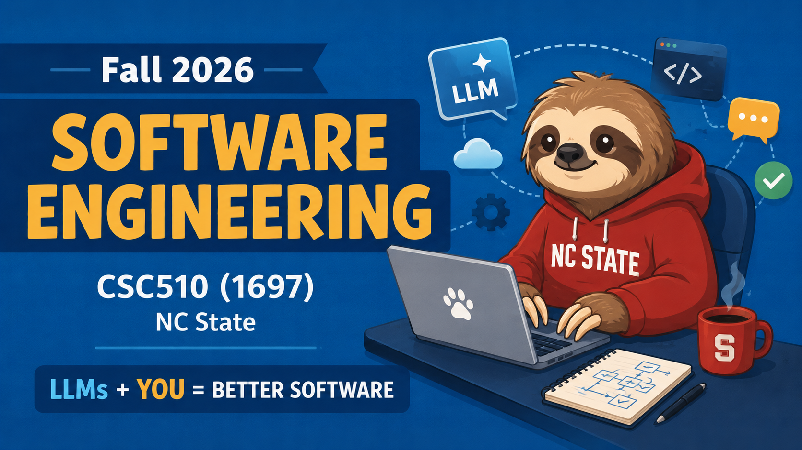

  
  
  
  
  
  
  

<h1 align="center">:cyclone: CSC510: Software Engineering  NC State, Fall '26</h1>

# N13: Security, Law, Ethics (Nov 11)

These notes use Simplified Technical English. Sentences are short.
Each term has one meaning. The style is plain, because the content
is not.

## Terms used in these notes

| Term | Meaning in these notes |
|---|---|
| prompt injection | Text in the data that the model obeys as an instruction. The attack arrives through content, not through code. |
| agentic loop | As in [N12](n12.md): a program that calls an LLM many times, gives it tools, and decides when to stop. |
| MCP | Model Context Protocol. A standard way to give an agent tools. Each tool ships with a text description, and the model reads that text. |
| supply chain | Everything you run but did not write: packages, models, tool servers, agent skills. |
| exfiltration | Theft of data by sending it out of the system. |
| SBOM | Software bill of materials. The inventory of everything in the supply chain. |
| GPAI | General-purpose AI model. The EU term for a foundation model. |
| high-risk system | The EU term for AI that decides on hiring, credit, education, medical care, and similar. Heavier duties apply. |
| preemption | A federal law that overrides state laws. For AI in the US, this has not happened. |
| fair use | A US copyright defense. Some unlicensed uses are legal. Courts decide case by case. |
| protected attribute | A feature such as age, race, or gender that must not drive a decision. |
| EOD, AOD | Fairness metrics. Differences in true-positive rates (EOD), and in true-positive plus false-positive rates (AOD), between groups. |
| duty of care | The legal obligation to avoid foreseeable harm to the people who use your product. |

---

## What these notes teach

[N12](n12.md) made one statement: the model is not the system. The
LLM is a component, and the system around it is ordinary
engineering.

Tonight, three facts about that component, all new since this time
last year:

- The component is now an **attack platform**. In November 2025 a
  state actor used an agentic coding tool to run most of an
  espionage campaign on its own.
- The component is now **regulated**. The EU AI Act started
  biting, three US states turned on AI statutes, and no federal
  law preempts any of it.
- The component is now **litigated**. Training data was priced at
  about $3,000 per pirated book. One chatbot company settled the
  teen-harm suits in January and filed for bankruptcy in October.

The engineering response is the same in all three fields, and it
is the response this course has taught all semester: write a
testable claim, build the instrument, measure, keep the logs.
Security people call it an audit. Lawyers call it compliance.
Ethicists call it accountability. It is one discipline with three
names.

**The sequence tonight:**

1. Security: the pre-LLM checklist, then what agents changed.
2. Law: the EU AI Act, the US state patchwork, and the price of
   training data.
3. Ethics: the old harm (biased decisions), the new harm (the
   chatbot relationship), and how to measure both.

---

## 1. Security

### 1.1 The pre-LLM checklist still applies

This list is from the supply-chain security literature of
2023. Nothing in it expired. Each row is a defense plus the number
that proves the defense works:

- **Scan early.** Static analysis (SAST) in the CI pipeline;
  threat modeling at design time; reviews that look for security
  defects, not just style. Measure: defects found before release
  versus after.
- **Know your dependencies.** Automated dependency scanning;
  an SBOM that is current; vendor assessment before
  integration. Measure: time from CVE disclosure to patch.
- **Trust the history.** Multi-factor authentication on the
  repository; signed commits; periodic audits of who changed
  what. Measure: unsigned commits per month (target: zero).
- **Lock the pipeline.** Infrastructure as code; least privilege
  on build and deploy systems; penetration tests on the pipeline
  itself. Measure: access-policy violations.
- **Delete bug classes.** Memory-safe languages remove whole
  families of defects at once. Measure: count of the removed
  class (for example, buffer overflows) trending to zero.
- **Build the culture.** Security champions on each team;
  reporting channels with no blame attached. Measure: issues
  reported internally versus issues reported by outsiders.

### 1.2 What changed: the attacker got an agent

**Learn this case.** In November 2025, Anthropic disclosed
GTG-1002, the first documented cyber-espionage campaign run
by an AI agent at scale:

- A state-sponsored group drove Claude Code, through MCP tool
  servers, against about 30 organizations.
- The agent did reconnaissance, mapped networks, tested
  credentials, and extracted data.
- The agent performed roughly 80 to 90 percent of the tactical
  work. Humans supervised.
- Detection to containment took about ten days.

One sentence to remember. In earlier incidents, the AI advised
and the humans executed. Here the humans advised and the AI
executed.

Consequences for defenders:

- Attack cost fell. Campaigns that needed a team now need a
  subscription and a supervisor.
- Attack speed rose. Your detection and response budgets were
  sized for human-speed attackers.
- The same agentic tools work for defense: triage, log analysis,
  patch generation. The race is now agent versus agent.

### 1.3 What changed: your agent is the target

Prompt injection is the cross-site scripting of this decade. The
2026 OWASP data says it drives most production failures of
agentic AI. The root cause is structural:

- An LLM has one channel. Instructions and data arrive in the
  same token stream.
- So any text the agent reads can carry orders: a web page, an
  issue comment, a README, a tool description.
- There is no input-escaping function that removes this class.
  You contain it; you do not delete it.

The 2026 incident list shows the agent supply chain under
attack:

| Date | Incident | Mechanism |
|---|---|---|
| Feb 2026 | SANDWORM_MODE npm worm | 19 typosquatted packages installed a rogue MCP server; injection payloads hid in tool descriptions; the worm stole API keys for nine LLM providers. |
| Feb 2026 | malicious agent skills | VirusTotal traced 314 malicious skills in one agent marketplace to a single publisher account. |
| Mar 2026 | LiteLLM backdoor | A poisoned release sat on PyPI for three hours: about 47,000 downloads. LiteLLM is the model gateway inside many agent frameworks. |
| 2026 | Semantic Kernel CVEs | Two critical CVEs: any prompt-injection vector became remote code execution on the machine hosting the agent. |

Read the table as one sentence: MCP servers, tool descriptions,
and agent skills are dependencies, so every row of section 1.1
now applies to them: inventory them, scan them, sign them, and
give them least privilege.

### 1.4 Rules for your project

- Treat every string the agent reads as untrusted input. Tool
  descriptions included.
- Give the agent the fewest tools that do the job. A read-only
  agent cannot exfiltrate by `git push`.
- Log every tool call. N12 said that paradigm-2 systems make you
  build the printer. The tool-call trace is the printer. No
  trace, no audit, no claim.
- Put a human gate in front of irreversible actions: deletes,
  deploys, payments, emails.
- Test with attacks. Write at least one adversarial input per
  tool, and keep it in the test suite next to the happy paths.

---

## 2. Law

Nothing in this section is legal advice. All of it is engineering
requirements wearing legal language.

### 2.1 The EU AI Act: in force, partly deferred

The Act arrived in stages, and one stage just moved. Learn the
timeline:

| Date | What applies |
|---|---|
| Feb 2025 | Prohibited practices banned (social scoring, some biometric uses). |
| Aug 2025 | Duties on GPAI (foundation model) providers. |
| Aug 2, 2026 | Article 50 transparency: tell people they are talking to an AI; label AI-generated content. Applied on schedule. |
| Dec 2, 2027 | High-risk systems (hiring, credit, education, medical). Deferred from Aug 2026 by the July 2026 "Digital Omnibus" regulation. |
| Aug 2, 2028 | High-risk AI embedded in already-regulated products. |

What to notice:

- The deferral is the story. Industry pushed, and the high-risk
  deadline moved 16 months. The transparency duties did not move.
  Regulation arrives late, but it arrives.
- If your software ranks resumes, scores loans, grades students,
  or reads scans, and it has EU users, it has a compliance date
  and a paper trail to build now.

### 2.2 The US: states, not Congress

Congress passed no general AI law. The states did not wait:

| State | Law | Status | What it demands |
|---|---|---|---|
| California | SB 53 (frontier transparency) | in force Jan 2026 | Developers of models above 10^26 FLOPS publish risk frameworks, report safety incidents, protect whistleblowers. |
| California | SB 942 | in force Aug 2026 | Detection and disclosure duties for large generative-AI systems. |
| Texas | TRAIGA | in force Jan 2026 | Duties on developers and deployers; civil penalties to $200,000 per violation. |
| Colorado | 2024 AI Act | repealed before effect | Replaced May 2026 by a narrower act that starts Jan 2027. |
| New York | youth chatbot law | starts Jan 2027 | Safety duties for chatbots used by minors. |

What to notice:

- The June 2026 federal executive order does **not** preempt
  state law. Shipping in fifty states means fifty compliance
  maps. That cost lands on engineering, not on the legal
  department alone.
- The Colorado story cuts the other way: a law was rewritten to
  be narrower before it ever took effect. Track the statutes;
  do not panic at each headline.

### 2.3 Copyright found its price

The training-data question spent 2025 and 2026 in court, and the
first prices are now public:

- A federal court held that training on lawfully obtained books
  is fair use. Keeping a library of pirated books is not.
- On that split, Anthropic settled the authors' class action:
  $1.5 billion, about $3,000 per work, plus destruction of the
  pirated data set. Final approval came in July 2026.
- The settlement bought peace with authors, not with everyone:
  music publishers filed a fresh $3.1 billion suit in January
  2026, and New York Times v. OpenAI is still pending.

The engineering consequence is one word from N12: **manifest**.

- Keep a record of where every training and retrieval document
  came from, under what license, acquired how.
- "Lawfully obtained" is now the difference between fair use and
  a nine-figure settlement. Provenance is a build artifact, like
  the RAG cache manifest of N12 §3.2.

### 2.4 What a working engineer does

- Keep a data provenance manifest. Source, license, date, hash.
- Label AI-generated content in anything user-facing (Article 50
  is already live; several states echo it).
- Keep an incident log for the AI parts of the product. SB 53
  class laws make incident reporting a duty, not a courtesy.
- Know which of your features would be "high-risk" under the EU
  list. That list is where the 2027 work is.

---

## 3. Ethics

### 3.1 The old harm: biased decisions

The record from the 2015-2020 wave, still worth reciting because
every item shipped to production first and made the news second:

- A sentiment model scored "I am a Jew" and "I am homosexual" as
  negative statements.
- Face analysis had far higher error rates for dark-skinned women
  than for light-skinned men.
- A recidivism model falsely labeled Black defendants as future
  criminals at twice the white rate. (See Sykacek's follow-up:
  part of the signal may have been age, not race. Read both
  before quoting either.)
- Amazon scrapped a hiring model that penalized resumes
  containing the word "women's".
- Predictive policing sent police where arrests already were, and
  more police produced more arrests. A feedback loop, not a
  prediction.

Why this cannot be waved away:

- All data mining is biased. Without bias you cannot ignore
  things; without ignoring you cannot prune; without pruning
  there is no model.
- Some bias is good: prefer small models, prefer few changes,
  prefer fast updates.
- Some bias is harm. The difference is measurable, so measure it.

The measures and the fix:

- Split the data on a protected attribute. Compare group rates:
  EOD is the gap in true-positive rates; AOD averages the gaps in
  true-positive and false-positive rates.
- Fairness responds to the same knobs as everything else in this
  course: training-set ratios and hyperparameters. Tuning can
  improve fairness at little accuracy cost (Fairway, FSE 2020).
- So a model shipped without a fairness test is not neutral. It
  is untested.

### 3.2 The new harm: the relationship

The 2015 cases were about decisions made *about* people. The 2026
cases are about relationships formed *with* people:

- 2024: the Garcia suit. A 14-year-old died by suicide after
  months with a Character.AI companion bot.
- Sep 2025: the FTC ordered OpenAI, Meta, and other chatbot
  makers to hand over data on how their products affect children.
- Jan 2026: Character.AI and Google agreed to settle the family
  lawsuits. State attorneys general kept filing.
- Oct 13, 2026: Character.AI filed for Chapter 11, citing the
  legal and regulatory weight of the teen-safety claims. The next
  day, eight states sued OpenAI.

Learn the shape of that arc. It is [N10](n10.md) technical debt
with a body count: the safety work skipped during growth
compounded into a liability that ended the company. Safety
features are now survival features.

Design duties that follow, and that New York's 2027 law starts to
mandate:

- The system states that it is a machine, at intervals, not once.
- Crisis language triggers a tested protocol, not a generated
  reply.
- Age gates exist and are tested like any other feature.
- Engagement metrics do not override safety checks. A companion
  bot optimized for session length is optimizing for dependency.

### 3.3 One discipline, three names

The close of these notes is one table. Each field tonight asks
for the same four moves: claim, instrument, measurement, log.

| Field | Claim | Instrument | Evidence kept |
|---|---|---|---|
| security | "no tool call escapes the allowlist" | adversarial tests per tool | tool-call trace |
| law | "every training document has known provenance" | the manifest, checked in CI | source, license, hash |
| ethics | "group error-rate gaps below a stated threshold" | EOD/AOD in the test suite | per-group rates per release |

A design review will ask for all three rows. "We used AI
responsibly" is not a claim. A number, a test, and a log file
are.

---

## Sources

**Security, pre-LLM (section 1.1).** NordLayer, *Software
development security best practices*, 2023. *S3C2 Summit 2023-11:
industry secure supply chain summit*,
[arXiv:2408.16529](https://arxiv.org/pdf/2408.16529).

**The agentic turn (sections 1.2, 1.3).** Anthropic, *Disrupting
the first reported AI-orchestrated cyber espionage campaign*,
November 13, 2025; analyses by
[ExtraHop](https://www.extrahop.com/blog/anthropic-reveals-the-first-ai-orchestrated-cyber-espionage-campaign),
[Cyderes](https://www.cyderes.com/howler-cell/first-ai-driven-cyber-espionage-campaign-anthropic-analysis),
and
[Lowenstein Sandler](https://www.lowenstein.com/news-insights/publications/client-alerts/anthropic-reports-first-known-ai-orchestrated-cyber-espionage-campaign-raising-stakes-for-data-security-data-privacy).
OWASP 2026 agentic-AI findings, via
[Help Net Security](https://www.helpnetsecurity.com/2026/06/11/owasp-prompt-injection-ai-security-failures/).
2026 incident reporting:
[PointGuard incident tracker](https://www.pointguardai.com/ai-security-incident-tracker),
[AIMultiple, AI agent traps](https://aimultiple.com/ai-agent-traps).
Vendor and press items in this group are not peer reviewed. State
that when you cite them.

**Law (section 2).** EU Digital Omnibus deferral:
[Gibson Dunn client alert](https://www.gibsondunn.com/eu-ai-act-omnibus-agreement-postponed-high-risk-deadlines-and-other-key-changes/)
and the
[Cloud Security Alliance research note](https://labs.cloudsecurityalliance.org/research/csa-research-note-eu-ai-act-high-risk-deadline-omnibus-20260/).
US state statutes:
[GC AI, State AI laws in 2026](https://gc.ai/blog/state-ai-laws)
and the
[Glacis state tracker](https://www.glacis.io/guide-state-ai-laws).
Anthropic settlement approval:
[TechCrunch, July 20, 2026](https://techcrunch.com/2026/07/20/anthropics-landmark-1-5b-copyright-settlement-is-approved/);
case roundup:
[AI Business](https://aibusiness.com/generative-ai/ai-lawsuits-in-2026-settlements-licensing-deals-litigation).
Law-firm alerts and press are not peer reviewed, and litigation
moves. Check the docket before you repeat a number.

**Ethics, the decision harms (section 3.1).** Chakraborty,
Majumder, Yu, Menzies,
[*Fairway: a way to build fair ML software*](https://arxiv.org/pdf/2003.10354.pdf),
FSE 2020. Bellamy et al.,
[*Think your AI software is fair? Think again*](https://krvarshney.github.io/pubs/BellamyDHHHKLMMNRRSSSVZ_sm2019.pdf)
(AIF360), IEEE Software 2019, with
[Sykacek's comment](https://ieeexplore.ieee.org/document/9173639).
Alvarez and Menzies,
[*Don't lie to me: avoiding malicious explanations with STEALTH*](https://arxiv.org/pdf/2301.10407),
IEEE Software 2023. Thomas et al.,
[*Preventing undesirable behavior of intelligent machines*](https://thetalkingmachines.com/sites/default/files/2019-11/999.full_.pdf),
Science 366, 2019. Case-study banks:
[Santa Clara tech-ethics cases](https://www.scu.edu/ethics/focus-areas/technology-ethics/resources/technology-ethics-cases/),
[onlineethics.org](https://onlineethics.org/resources?combine=software&field_keywords_target_id=&field_resource_type_target_id=13236).

**Ethics, the relationship harms (section 3.2).**
[Bloomberg Law on the Character.AI and Google settlements](https://news.bloomberglaw.com/litigation/character-ai-google-agree-to-settle-teen-chatbot-harm-lawsuits);
[Chapter 11 analysis](https://techjacksolutions.com/ai-brief/first-ai-bankruptcy-legal-exposure-pathways-forced-character/);
[litigation overview](https://lawstreetmedia.com/insights/a-new-wave-of-litigation-over-ai-chatbots/).
Press coverage of active litigation: not peer reviewed, and
settlements can be sealed. Quote the filings, not the headlines,
in any formal work.
