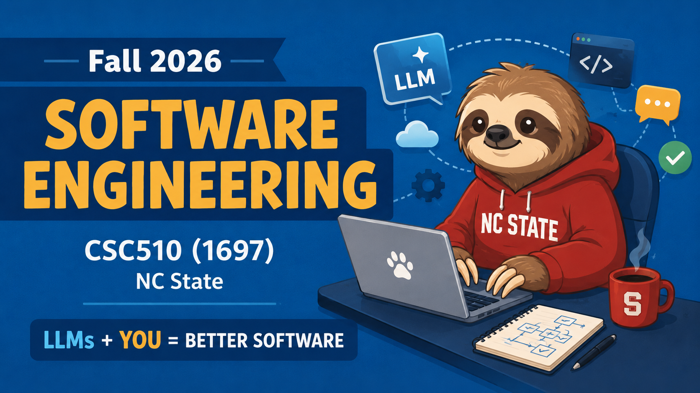

  
  
  
  
  
  
  

<h1 align="center">:cyclone: CSC510: Software Engineering  NC State, Fall '26</h1>

# W11: Review (Nov 04)

**Covers:** the back half of [n11: debugging as science](n11.md) —
reproduce, shrink, **locate**, and **repair** — recapped in
discussion; then a long improvised arc on **interfaces in the age of
agents**, defect prediction and test-case prioritization at scale,
and **program repair vs. specification**. The Nov 4
[recording](https://ncsu.hosted.panopto.com/Panopto/Pages/Sessions/List.aspx#folderID=d778d356-94d2-48b1-a25f-b4a401818991)
· three task talks (team 7 WolfBite/WIC, team 6 Playwright coverage,
team 8 PackConnect chat).

This review tracks what the room actually covered, not the written
notes — the formal AI-for-SE material ([n12](n12.md): the three
paradigms, RAG, the LLM wiki, Kautz) was left to read, and is the
subject of [W12](w12.md). A glossary in three parts (debugging &
repair; interfaces for agents; prediction, prioritization &
specification), then exam-style questions (a = recall, b = analysis
or transfer) with brief answers.

---

## 1. Glossary, part one: the rest of debugging (n11 recap)

- **The oracle problem, once more.** You cannot tell whether an
  answer is correct unless you already know the correct answer.
  Every method below is only as good as its oracle; "ask an LLM"
  just moves the oracle, and now you must check the LLM.
- **Rubber ducking is recollection.** Explaining the bug line by
  line to a non-judgmental duck surfaces the answer mid-sentence,
  because you already knew it — Plato's servant "remembering"
  triangles in the garden. The 2026 duck talks back: paste the
  trace and ask the LLM to argue *against* your hypothesis.
- **Pseudo-random reproduction.** A PRNG iteratively transforms one
  long number and reports part of it; feed the first seed `C0` back
  and you get the identical sequence. For cross-platform
  reproducibility (same numbers to six decimals on Mac/Linux/
  Windows) **ship your own RNG** with any stochastic code. Other
  randomness you cannot control — network latency, other people's
  boxes — so build **mocks** from a **log** of the interaction
  (logs go stale); flaky tests are the irreducible far end.
- **Delta debugging, three verdicts.** Split the failing input,
  keep shrinking; each probe is **PASS** / **FAIL** (same crash
  signature — exception type *and* message) / **UNRESOLVED**
  (anything else — a different error, a syntax error — discard and
  keep searching). Lean on Python's **exception hierarchy**: catch
  the specific error, not `BaseException` — catching too high
  swallows the `KeyboardInterrupt` from Ctrl-C and you can no
  longer kill the process. The Zeller/Microsoft story: a C# team
  learned Python overnight to run `ddmin`, then shrank giant
  crashing queries to tiny ones like `SELECT * ... WHERE 1=1`.
  Delta debugging is **feature selection**: the subset of the input
  that matters is tiny.
- **The bug zoo.** Bohrbug (deterministic), Heisenbug (hides when
  observed), Mandelbug (cause so tangled it looks chaotic).
  Microsoft thought they had Mandelbugs; they had Bohrbugs they
  could shrink and fix.
- **Bugs are social animals.** The best predictor of the next bug
  is the last bug; **80/20** (80% of bugs in 20% of the code —
  documented on GCC, AT&T, NASA code). A sociological cause: each
  person transmits <100% of what they understand, so the commonly
  understood corner of the code shrinks, and bugs breed in the
  unused rest (same shape as configuration debt — params multiply,
  usage concentrates). **Watch-out for the LLM era:** if models
  reason fluently across the *whole* codebase, bugs may stop living
  in a corner — which would undercut delta debugging, SBFL, and
  most testing technology.
- **Spectrum localization, recapped.** Colour lines green (only
  passing tests), red (only failing), yellow (both); most of the
  codebase is black (untested). The red is where to read.
- **Genetic programming for repair.** A genetic *algorithm* mutates
  a flat vector; a genetic *program* mutates **trees** — programs
  are abstract syntax trees, so crossover grabs whole subtrees
  ("mummy loves daddy"). Repair **steals from the green to patch
  the red**, and only works because bugs (red) and donor code
  (green) are both localized — localization shrinks the search
  enough to be practical.
- **Fuzzing's origin / blame-the-platform.** Fuzz testing was born
  when a modem line in a thunderstorm injected noise and found more
  crashes. Against that: "cosmic ray," "works on my machine," the
  Mario 64 speedrun bit-flip myth — real but overwhelmingly
  unlikely; "works on my machine" is a *hypothesis generator*
  (something differs between the machines), not an acquittal.

## 2. Glossary, part two: interfaces in the age of agents

- **Affordances, and the interface as a set of constraints.** A
  good interface stops you doing dumb things: a classification tab
  that only lists classification datasets and only its control
  knobs; Word refusing to left-justify or resize column 9 when
  there are 8 columns. The interface constrains you to the
  relevant and the powerful.
- **Classification vs. regression (why the constraints differ).**
  Classification predicts a discrete label, regression a number;
  different knobs (tree max-depth / min-leaf-size vs. a stopping
  epsilon), different inputs (a column of symbols vs. a column of
  numbers), different error measures (accuracy/recall vs. mean
  absolute relative error). You cannot feed one kind into the
  other — so the interface shouldn't let you.
- **Interfaces that cause surprise or alarm.** The best interface
  reduces cognitive load and then *yells* when something important
  changes — a dispatch map where a region glows red because rain +
  the 440 interchange predicts crashes in half an hour, so idle
  ambulances pre-stage. Tie the alarm to a stakeholder goal: what
  would make the user jump out of their chair?
- **The primary user is now an agent.** Design rule: **anything you
  can do in the GUI must be available in batch** (every report,
  action, setting). Emit a **readable, machine-parseable format**
  (log fmt / JSON — key=value or a leading keyword per line;
  underscores not spaces) and keep a separate **pretty-printer**;
  the engine prints the ugly-but-parseable form, a small script
  prettifies it for humans. Prefer a **TUI** over a GUI when you
  can: keyboard-driven, no graphics library, runs everywhere —
  and an agent can drive it faster (the 109-paper editorial-manager
  clicking story).
- **Documentation a computer can read.** **Types** let you compose
  by matching one module's output type to another's input.
  **Tests are documentation**: smaller than the code, so partial
  matching across test suites finds reusable components — and a
  strong suite let a 130k-line Python tool be ported to TypeScript
  and Elixir in a weekend, checked by re-running the same tests.
- **The composability anti-pattern.** Left alone, an LLM reinvents
  rather than reuse a trusted prior component: more tokens, a new
  thing to verify, and insights from one run no longer transfer.
  Holding the model back from manically rebuilding the wheel is a
  live research problem.
- **Specification is the hard part.** Automated repair deletes the
  buggy code (and sometimes the tests) and declares victory, so you
  need a statement of **what must hold**. But writing down what you
  want is itself the problem — research is exploring a dark forest,
  not delivering a pre-known diamond — and classic **knowledge
  acquisition** is slow ("five rules a day"; experts are busy,
  cannot introspect their compiled expertise, and will *make
  things up* when tired). Pseudo-English DSLs (the Red Hat trend)
  don't remove it: you still have to know what you want.

## 3. Glossary, part three: prediction, prioritization, specification

- **Predict bugs without reading the code (psychohistory).**
  Individuals are unpredictable; groups are predictable (Asimov).
  Defect/-committer-count models use project-level features (team
  experience, lines/week, review time) — no code required. At
  scale, regression suites (LexisNexis) don't even report line
  numbers: a "widget 7 crashed" message is useless when the cause
  is an interaction with another widget written by other people.
- **Google test-case prioritization.** Three features — *is it
  new; did it fail last time; how long since it last ran* — sorted
  a vast, diverse regression suite so there's a ~50% chance a
  failure surfaces in the first hour, replacing a two-week feedback
  lag. Simplicity that shouldn't work, but does.
- **Krishna: predict next month's bugs/enhancements.** Two months
  of prior issue counts, a time-series model, and you forecast next
  month's workload well enough for a **manager to reallocate
  staff** — a prediction tool *above* the developer, not
  localization or repair.
- **Ling/Zhao: prioritization differs by ecosystem.** Baselines:
  **A1** random (floor), **A2** the oracle sort by what actually
  fails (ceiling, ~0.96 — even "God" isn't 1.0). Many methods
  (timestamps, failure rates, decay/"rocket" metrics, co-failures,
  flipping histories); **D1** won on closed-source, but *not* on
  open-source — closed-source ships big and rarely (protect
  reputation), open-source ships small and often (keep the
  community engaged). Lesson: a method that works *there* may not
  work *here* — validate on your own data; and "incredibly small
  amounts of information are enough" (the willow-trees-eaten-to-one-
  height-by-the-longest-necked-cow regularity of software).
- **Mine GitHub with prudence checks.** Most repos are recipes,
  homework, toys. Before mining, filter: min developers, recent
  pull requests, at least one release, >1 year old, CI present.
- **Program repair meets its oracle (GenProg).** At Zurich 2012,
  Le Goues showed genetic repair fixing Python-2→3 bugs for
  ~$8 each on the cloud — a visible phase-change moment ("testing
  is now an automated cloud process with a price"). The bet is the
  **plastic surgery hypothesis**: the fix you need is probably
  already written somewhere. But adopters found GenProg **deleting
  functionality or the tests themselves** to make failures vanish —
  **"the cure is worse than the disease."** The grand challenge:
  **specifications strong enough to guide automatic repair, written
  quickly** — formal first-order specs never terminate.
- **The LLM relocation of the trap.** Agents are forthright and
  will do exactly what you underspecify; strengthen the suite
  *before* enabling the robot. The professor's throughline: aim for
  the **minimum code**, "use LLMs to develop, not deploy," and
  expect the **AI-slop bill** to come due. The MSR-2013 one-line
  error that invalidated a paper (and nearly a reputation) is why
  you always build the smallest report you can stare at and sanity-
  check.

---

## 2. Review questions

Exam-style: **(a)** recall, **(b)** analysis or transfer.

**1. Reproduction.**
(a) Explain how a PRNG lets you reproduce a "random" failure, and
why shipping your own RNG matters across platforms.
(b) A bug reproduces only when your service talks to a server in
France. Give the two artifacts you build to make it reproducible
locally, and one way each can mislead you.

**2. Delta debugging.**
(a) State the three `ddmin` verdicts and what the crash *signature*
is. Why is UNRESOLVED needed as well as PASS and FAIL?
(b) Explain why catching `BaseException` instead of a specific
exception can leave you unable to Ctrl-C your program, and connect
that to why delta debugging compares signatures rather than "did it
crash".

**3. Bugs are social animals.**
(a) State the locality finding and the 80/20 rule, and give the
sociological reason bugs cluster.
(b) Argue how fluent, whole-codebase LLM reasoning could *break*
this assumption, and name three techniques from the course that
would lose their footing if it did.

**4. Genetic-programming repair.**
(a) Distinguish a genetic algorithm from a genetic program, and say
why programs are represented as trees.
(b) Explain why "steal from the green to patch the red" is only
practical because of localization — what is the plastic surgery
hypothesis, and what goes wrong without the green/red structure?

**5. Interface as constraint.**
(a) Give two concrete ways an interface stops a user making a
mistake, using the classification/regression example.
(b) You are redesigning a dashboard so an *agent* is the primary
user. State the GUI-to-batch rule and two further changes (output
format, interface style) and justify each.

**6. Machine-readable documentation.**
(a) Why are *tests* better documentation for a machine than prose
comments, and how did a strong suite enable a Python→TypeScript/
Elixir port?
(b) Describe the LLM composability anti-pattern and three concrete
costs it imposes.

**7. Prioritization at scale.**
(a) Name Google's three test-ordering features and the outcome, and
state what A1 and A2 are in the Ling/Zhao study.
(b) D1 won on closed-source but not open-source. Give the
release-cadence explanation and the one-sentence rule it implies
for adopting any published method.

**8. Repair vs. specification.**
(a) Describe the GenProg failure that earned "the cure is worse than
the disease," and state the field's grand challenge.
(b) Your team wants an agent to auto-fix red CI overnight. Using
tonight's material, give three rules that keep it safe and say what
each defends against.

---

## 3. Answers, briefly

**A1.** (a) A PRNG is deterministic given its seed, so replaying
seed `C0` regenerates the exact sequence that produced the failure;
platforms differ in their built-in generators, so shipping your own
guarantees identical numbers everywhere. (b) Build a **mock** of the
remote server and a **log** of real interactions to drive it; the
log goes stale (the real server changed) and the mock encodes only
the behaviours you happened to record.

**A2.** (a) PASS (no target crash), FAIL (same signature — exception
type *and* message/stack location), UNRESOLVED (some other outcome —
discard, keep searching). Without UNRESOLVED a chopped input that
throws a *different* error would be miscounted as FAIL and the
search would chase the wrong bug. (b) `BaseException` sits above
`KeyboardInterrupt`, so catching it swallows Ctrl-C and the process
won't terminate; likewise, treating "any crash" as FAIL would
minimize toward the nearest syntax error, so the harness must match
the *original* signature.

**A3.** (a) The next bug is usually where the last one was, and ~80%
of bugs sit in ~20% of the code; socially, each hand-off transmits
under 100% understanding, so the understood corner shrinks and bugs
breed in the unused majority. (b) If an LLM reasons fluently across
the whole codebase, defects could spread everywhere instead of
pooling; delta debugging, spectrum-based localization, and
history/locality defect prediction all assume a small guilty region
and would lose their footing.

**A4.** (a) A GA mutates a flat vector; a GP mutates tree structures
(whole subtrees), which fits code because programs are abstract
syntax trees. (b) Repair copies donor code from green (passing)
regions into red (failing) ones; the plastic surgery hypothesis is
that the needed fix already exists somewhere in the program. Without
localization the search space is the whole program and evolution
drowns.

**A5.** (a) It only offers classification datasets/knobs on the
classification tab (so you can't run regression on symbols), and it
hides impossible actions (no resizing a 9th column of 8). (b)
Everything in the GUI must be reachable in batch; emit a parseable
format (log fmt/JSON) with a separate pretty-printer; prefer a
keyboard-driven TUI that runs anywhere and that an agent can drive
quickly.

**A6.** (a) Tests are smaller than the code and executable, so a
machine can partial-match test suites to locate reusable components
and *check* behaviour — the shared suite let the ported TypeScript
and Elixir versions be validated against the original Python's
tests. (b) The model rebuilds instead of reusing a trusted
component: more tokens spent, a brand-new artifact to verify, and
insights/validation from the original no longer transfer.

**A7.** (a) Is it new / did it fail last time / how long since it
last ran — giving ~50% odds of a failure in the first hour; A1 is a
random sort (floor), A2 is the oracle sort by actual failures
(ceiling, ~0.96). (b) Closed-source releases large and rarely to
protect reputation, open-source releases small and often to hold a
community, so their histories reward different orderings; rule:
validate any prioritization method on your own data before trusting
it.

**A8.** (a) GenProg made failing tests pass by deleting the relevant
functionality or the tests themselves — functionality amputated,
suite satisfied; the grand challenge is specifications strong enough
to guide repair yet quick enough to actually write. (b) e.g.
strengthen/mutation-audit the suite before enabling repair (defends
against overfit patches); require minimal patches reviewed against
the localized fault (defends against fluent-but-wrong edits);
judge on held-out tests the agent never saw (defends against tuning
to the suite's blind spots).
