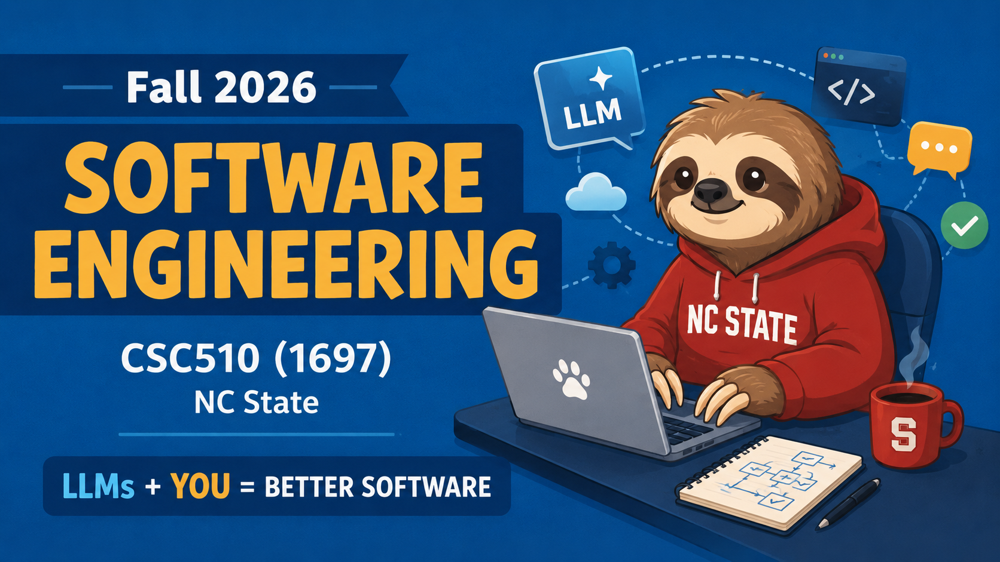

  
  
  
  
  
  
  

<h1 align="center">:cyclone: CSC510: Software Engineering  NC State, Fall '26</h1>

# W12: Review (Nov 11)

**Covers:** the formal AI-for-SE material from [n12](n12.md), now
lectured — the **three paradigms** (contrast / attention / reward),
the **attention economy** and the **ironies of automation**, and
**neuro-symbolic** method combinations (Kautz) — then a long
**history of open source**, from the Homebrew Computer Club to the
2026 open-weight debate. The Nov 11
[recording](https://ncsu.hosted.panopto.com/Panopto/Pages/Sessions/List.aspx#folderID=d778d356-94d2-48b1-a25f-b4a401818991)
· four task talks (team 8 Connect, team 9 test-budget, team 10
Blucose, team 11 Weekly's).

The open-source story ran long and stopped at the **open-weight**
question; the security/law/ethics material is still ahead. A
glossary in four parts (paradigms; attention & automation;
neuro-symbolic; open source), then exam-style questions (a = recall,
b = analysis or transfer) with brief answers.

---

## 1. Glossary, part one: the three paradigms

- **"X is all you need."** Three families, each a bet on which
  small signal is worth the attention: **contrast** (the difference
  between good and bad examples), **attention** (a learned
  weighting over the input), **reward** (one scalar from the
  environment). Industry went nuts on **attention** because one
  mechanism served a huge range of tasks.
- **Why attention won the hardware.** Attention began as a minor
  post-processor bolted onto RNNs/CNNs; the *Attention is all you
  need* paper (2017; ~280k citations) deleted the recurrence. RNNs
  must process **sequentially** (token *t* waits for *t−1*); pure
  attention scores every token against every token in one
  **parallel** matrix multiply that GPUs love — so training scaled
  and models grew.
- **…but it isn't *all* you need.** The accidental Claude source
  dump showed a few core neural facilities wrapped in an enormous
  amount of **symbolic** Unix glue — grep, glob, tiny scripts.
  Marvin Minsky's *Society of Mind*: the brain is a kluge of
  millions of little special-purpose mechanisms. Open Claude and
  you see Minsky.
- **Reward / reinforcement learning.** Learn by trial from a scalar
  reward, often **tabula rasa** (from scratch): the Atari-from-
  pixels learner, and AlphaGo Zero reaching superhuman Go with *no*
  human game books. RL needs almost no background data; attention
  needs vast amounts. The attention-vs-reward "war" between labs is
  real, but today everyone combines them.
- **Contrast sets / ripple-down rules (the small-c paradigm).**
  Compton's trick: don't model everything, model the **difference**.
  A rule written as "if true then not-sick" was *correct when
  written*; when a flu case arrives, guess a **patch** from the
  delta between the old context and the new one and show it to the
  expert. Result: tens of thousands of expert systems maintained in
  *seconds a day*. Crazy-efficient with a human in the loop, yet
  commercially tiny — **small-c contrast, big-A attention,
  medium-R reward**.
- **Small AI is stirring ("Jev").** The most-downloaded foundation
  model on Hugging Face only answers **yes/no** — a classifier, no
  chat, orders of magnitude fewer tokens, far faster. For many SE
  jobs a yes/no oracle is all you want, and the download count
  signals real appetite for small systems over big ones.

## 2. Glossary, part two: attention economy & ironies of automation

- **Information is cheap; attention is scarce (Simon).** The one
  constant we cannot scale — faster CPUs, bigger screens, more data
  — is the **human attention span**. 1970s management information
  systems buried managers in printouts (filed in the "round filing
  cabinet"); **decision support systems** fixed it by reporting
  only the few factors that trigger a decision.
- **Piggy: an expert system smarter than its builders (1986).** A
  Fortran farm model dumped columns of numbers no farmer could
  read; the giveaway was **grease marks** where experts ran a
  finger down a column, spotting *runs* of abnormal values, each
  run triggering a fix (with priorities when two overlap). Encoding
  those runs as a **rule-based** system beat the humans — pure
  decision-support discipline: report only what changes the
  decision.
- **Experts attend to less.** Chess masters see chunks and tactics
  (a knight fork), not 32 pieces; the novice reads `i = i+1`, the
  expert reads "the loop increment"; novice "open the file and read
  columns," expert "select these columns from the relation."
  Expertise is compiled attention.
- **Ironies of automation (Bainbridge, 1983).** Automate the easy
  tasks and humans are left only the rare hard ones — but, out of
  practice, they can't handle them when they arrive. The
  self-driving-car researcher who, months in, chatted to his kids
  instead of watching the road; it takes ~9 seconds to go from
  relaxed to reacting, and the crash takes 3 — the car flipped,
  the kids crawled out asking "daddy, you okay?" Devices that are
  usually right but sometimes very wrong lull the monitor.
- **The attention economy is adversarial.** Infinity scroll, little
  coloured badges, the phone your hand finds before your eyes
  focus — every device competes for the scarce resource. Even an
  LLM drives you to work at its thin top-of-stack pace for too many
  hours, which is its own kind of fatigue.

## 3. Glossary, part three: neuro-symbolic

- **AI is software — look inside it.** As software engineers, split
  AI into parts and improve the parts. Kautz's *The Third AI
  Summer* (2020) gives the lens: **neuro** (neural nets, biologically
  inspired, the "chooser" that does fuzzy partial-matching) vs.
  **symbolic** (exact algorithms — you invert a matrix with an
  O(mn) routine, not a neural net).
- **Neuro for development, symbolic for deployment.** When you ask
  an LLM to build a program, a neural layer talks and partial-
  matches, and underneath a symbolic layer composes exact pieces —
  exactly what the Claude dump revealed (neuro configuring vast
  symbolic glue).
- **Combinations are designs, and there are alternatives.** Example
  pipeline: neuro reads English syllabi → emits ~2000 lines of
  **Prolog** constraints → a symbolic optimizer answers "how do I
  graduate fastest?" The **better-together** result (with Srinath):
  a fast symbolic learner knocks off the easy cases and **seeds**
  the slower neural one, beating either alone. The point:
  "attention is all you need" is one cell of a space — like
  redesigning a car by splitting it into generator + wheels +
  cabin, there are always other designs. Be the rabbit that
  *questions the headlights*, not the one frozen on the road.

## 4. Glossary, part four: the history of open source

- **Homebrew Computer Club.** Hippies who shared everything: show
  up with a design or a BASIC interpreter and give it away; type
  your whole OS in as hex to boot a borrowed machine.
- **Gates's open letter (Feb 2, 1976).** Bill Gates told the
  hobbyists that sharing his BASIC was **theft** and that quality
  needs paid, closed software. Then he **licensed** an OS to IBM
  while keeping copyright and resale rights — IBM believed "nobody
  makes money on software, only hardware" — and shipped **MS-DOS**,
  based on a bought-in "quick and dirty" OS. That deal made him
  one of the richest people alive.
- **Gift economies.** Giving-to-gain-status is prehistoric: the
  village "king" runs the best banquet, and the **gift must keep
  moving** or it dies. Open source re-used a pattern tens of
  thousands of years old, it did not invent it.
- **Stallman and copyleft.** Richard Stallman gave us GCC (a
  platform-independent optimizing C compiler) and Emacs; refused a
  printer's header files once too often and founded the **Free
  Software Foundation** and **GNU** ("GNU's Not Unix"). His
  **viral/copyleft** licence (GPL) is the gift made legal: use it,
  and when you pass it on you must pass it on under the same terms.
  (Earlier he'd spent a year single-handedly re-cloning Symbolics'
  Lisp OS nightly for LMI — the work of seven programmers — until
  it broke him.) In 1997 others split off the less-ideological term
  **"open source."**
- **Linux and Linus's law.** Linus Torvalds released the Linux
  kernel in Aug 1991 ("just a hobby") and built the distributed
  workflow (later **git**) that let the world collaborate.
  **"Given enough eyeballs, all bugs are shallow."**
- **Gates was wrong — giving away became power.** The 1998
  "Halloween documents" called open source an existential threat;
  Microsoft fought the browser/OS wars (IE bundled into Windows).
  Then **Red Hat's 1999 IPO** ($14→$52 in a day, 8th-biggest ever),
  **VA Linux** (+700% in a day), **IBM's $1B into Linux** (2000),
  and Google's cloud/**Kubernetes**: you give away complex software
  *to control it* — board seats and direction — the gift economy as
  market power.
- **Reconsidering open source (the 2026 turn).** Big OSS projects
  have **emergent stable properties** (you can predict committer
  counts a year out — groups are predictable). But a dependency
  tree of 100k packages is an **attack surface**: expired
  JavaScript domains, **Heartbleed**, the **left-pad** 11-line
  package yanked over a name dispute, and **XZ Utils (2024)** —
  two years of social engineering to inherit a decompression
  library and plant a kernel-level backdoor. And **Linus's law was
  never measured**: LLMs now surface bugs sitting for decades in
  heavily used code, so "enough eyeballs" made software **bug-rare**
  (used in narrow bands), not **bug-free**. The open story now runs
  into governments weighing bans on non-open models — the
  **open-weight debate**, continued next week.

---

## 2. Review questions

Exam-style: **(a)** recall, **(b)** analysis or transfer.

**1. The three paradigms.**
(a) Name the three paradigms and the one-line signal each attends
to, and say which one industry built on.
(b) Explain *why* attention beat RNNs on hardware, and why "it isn't
all you need" — cite what the Claude dump and Minsky's *Society of
Mind* show.

**2. Reward vs. attention.**
(a) What does *tabula rasa* mean, and give the two classic
reinforcement-learning results.
(b) Contrast the data appetites of reinforcement learning and
attention models, and explain why 2026 systems combine them rather
than pick one.

**3. Contrast sets.**
(a) Describe a ripple-down rule: what is stored, and when is the
expert asked?
(b) Contrast methods are commercially tiny yet maintain tens of
thousands of expert systems for seconds a day. Explain the
efficiency, and why the commercial footprint is nonetheless small.

**4. Attention economy.**
(a) State Simon's claim and the one thing we cannot scale, and
explain how decision support systems answered 1970s information
overload.
(b) Tell the Piggy story and explain how "report only what triggers
a decision" let a rule-based system beat its own human authors.

**5. Ironies of automation.**
(a) State Bainbridge's irony in one sentence.
(b) Use the self-driving-car story to explain why "usually right,
sometimes very wrong" is the dangerous regime, and connect it to how
you should treat an agent's output.

**6. Neuro-symbolic.**
(a) Define neuro vs. symbolic and give one task each is right for.
(b) Explain "neuro for development, symbolic for deployment" using
the syllabi→Prolog→optimizer pipeline, and state what the
better-together result showed.

**7. Open-source history.**
(a) What did Gates claim in 1976, and how did the IBM/MS-DOS deal
contradict his own argument about who profits?
(b) Explain copyleft as a gift economy — what "the gift must keep
moving" means for a GPL licence — and how IBM and Google turned
giving-away into control.

**8. Reconsidering open source.**
(a) State Linus's law and the finding that it was never measured.
(b) Using XZ Utils and left-pad, explain why a 100k-package
dependency tree is an attack surface, and what "bug-rare, not
bug-free" means.

---

## 3. Answers, briefly

**A1.** (a) Contrast (good/bad difference), attention (learned
weighting over the input), reward (one scalar from the environment);
industry built on attention. (b) RNNs run sequentially (token *t*
waits for *t−1*) while attention scores all tokens in one parallel
matrix multiply, so it scaled on GPUs; but the Claude dump showed
mostly symbolic Unix glue around a few neural cores, and Minsky's
*Society of Mind* frames intelligence as a kluge of many small
mechanisms — attention is one component, not the whole.

**A2.** (a) *Tabula rasa* = learning from a blank slate with no
prior examples; Atari-from-pixels and AlphaGo Zero (superhuman Go
with no human game records). (b) Reinforcement learning needs almost
no background data (it learns from the reward), attention models
need vast corpora to set their weights; combining lets each cover
the other's weakness, so no single mechanism dominates.

**A3.** (a) Store only the **difference** (the condition present in
the new case and absent when the old rule was written), and ask the
expert only at the point of the last error. (b) Patching just the
delta keeps maintenance to seconds a day with a human confirming
each patch; but each system must be fitted to its data and expert,
so it never ships as one general product the way an attention model
does — hence the tiny commercial footprint.

**A4.** (a) In an information-rich world the scarce resource is
attention; the one thing we cannot grow is the human attention span;
decision support systems reported only the few trigger factors
instead of every number. (b) A Fortran farm model dumped unreadable
number columns; experts scanned for *runs* of abnormal values, each
triggering a fix; encoding those runs as rules (reporting only what
changes the decision) produced a system that optimized better than
the people who built it.

**A5.** (a) The more you automate, the more the human job becomes
monitoring — which humans do badly, losing the skill for the rare
hard case. (b) A device usually right lulls the monitor, so when it
fails (the ~9 seconds to react vs. the 3-second crash) the human
isn't ready; treat an agent's output as plausible-not-true and stay
in the loop, because its rare wrong answers arrive when your
vigilance has decayed.

**A6.** (a) Neuro = neural, fuzzy partial-matching (good for reading
messy text); symbolic = exact algorithms (good for inverting a
matrix or running a solver). (b) A neural layer reads English
syllabi and emits Prolog constraints, then a symbolic optimizer
answers "graduate fastest?" — neuro builds, symbolic runs; the
better-together result showed a fast symbolic learner seeding the
neural one beats either alone.

**A7.** (a) Gates called sharing software theft and said quality
needs paid, closed code — yet he profited precisely by *licensing
software* to IBM (keeping copyright and resale), while IBM assumed
money lived only in hardware. (b) Copyleft forces each recipient to
pass the software on under the same shareable terms, so the gift
keeps moving (a dead, unshareable gift is worthless); IBM and Google
gave away complex software (Linux, Kubernetes) to win board seats
and steer its direction — status and control through giving.

**A8.** (a) "Given enough eyeballs, all bugs are shallow" — never
empirically measured, and LLMs now find decades-old bugs in
heavily-used code. (b) When your software is built from 100k
packages, any one (an expired JS domain, an inherited library like
XZ, a yanked 11-line package like left-pad) can inject failure or
vanish; heavy use makes OSS **bug-rare** — exercised in narrow,
well-worn bands — but not **bug-free**, as the untouched majority
still hides defects.
