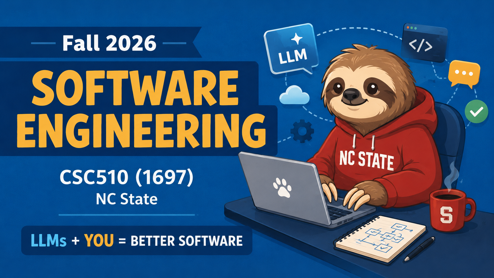

  
  
  
  
  
  
  

<h1 align="center">:cyclone: CSC510: Software Engineering  NC State, Fall '26</h1>

# W13: Review (Nov 18)

**Covers:** the last lecture — a wrap on **symbolic AI** and **formal
methods**. After a group recap of [n12](n12.md) (the three paradigms,
open source, neuro-symbolic, the ironies of automation), the night built
a live **constraint-satisfaction** demo — the menu problem rewritten in
**Prolog** and **Python** — to answer a previous team's scaling trouble;
argued for a **missing layer** between business tasks and the AI
algorithms that serve them; then gave a primer on **formal methods**
(Z3, SMT, SAGE, loop invariants). Two task talks closed with hard
**M0** lessons about testing against real data. The Nov 18
[recording](https://ncsu.hosted.panopto.com/Panopto/Pages/Sessions/List.aspx#folderID=d778d356-94d2-48b1-a25f-b4a401818991)
· one task talk night (unit-parsing bug; allergen-notification
precision/recall).

The security/law/ethics notes ([n13](n13.md)) are assigned reading and
on the exam — "everything is in the exam." A glossary in four parts
(constraint satisfaction; the SE of symbolic AI; formal methods; two M0
lessons), then exam-style questions (a = recall, b = analysis or
transfer) with brief answers.

---

## 1. Glossary, part one: constraint satisfaction and the menu demo

- **Constraint satisfaction problem (CSP).** Fill each slot with a value
  so that every constraint holds. A **SAT solver** (satisfiability) is
  the hard-wired case: each variable is only **yes/no**, and you seek an
  assignment that makes the whole formula true. A CSP generalizes it:
  each slot takes one of several values (Monday…Friday; a dish from a
  menu). Richer solvers add numerics, nested structures, and
  specialists per theory. The menu task — fit a dollar budget and a
  sugar/calorie cap from real restaurant menus — is a CSP, and CSPs are
  a decades-old, well-studied corner of symbolic AI.
- **Prolog (programming in logic).** A theorem prover from the 1970s.
  You state the world as **facts** (`item(venue, dish, kind, sugar,
  calories, cost)` reads like a database row) and rules; "we don't code,
  we draw." The engine proves goals **left-to-right, top-down**, so the
  *order* you write sub-goals controls the search.
- **Knowledge representation first.** Before solving, decide how to
  represent the problem — the choice dominates performance. In the menu
  code, picking the **venue before the dishes** means the search is "for
  each of 20 venues, choose items *within it*," not "pick a starter
  anywhere, then sprint next door for a main." One re-ordering collapses
  the search space.
- **Generate-and-test.** Generate candidates, then test them against the
  constraints. The rule: **push the tests as early into the generator as
  you can.** Generating every 0-to-120-year life plan and only *then*
  checking "did you finish school? stay out of prison?" is bad karma;
  applying the cheap budget test before the sugar/calorie tests prunes
  far sooner. (A quick prototype may test late and still win if the
  space is tiny; for scale, move the tests deep into generation —
  partial evaluation.)
- **The menu result.** The Prolog version found **252 plans** under a
  **$40** budget, **60 g** sugar cap, and **2700** calories, in about
  **18 MB** of RAM — where the earlier LLM-based menu system ran out of
  memory and would not even terminate. A near-identical Python version
  (regex-parsed items, a `yield`-based plan generator) ran in the same
  time. The space was small (20 venues, ~1–4 dozen items each), so even
  the naive generate-and-test was fine.

## 2. Glossary, part two: the software engineering of symbolic AI

- **AI is software — and it is bigger than the frontier labs.** "AI" is
  not only what OpenAI and Anthropic sell. **Jeb/Jev** (the most-
  downloaded Hugging Face foundation model, from a team that left a big
  lab) returns small, cheap outputs at a fraction of the token cost and
  power; on **tabular data** collected *for a reason*, a plain decision
  tree matches foundation models at a tiny fraction of the cost. On
  tables, the word "window" can mean something local to one column — so
  the whole-world context that helps a chatbot can *hurt*.
- **Neuro for development, symbolic for deployment.** A neural layer is a
  fuzzy partial-matcher (good at reading messy English); a symbolic
  layer runs exact algorithms (good at a solver or a matrix multiply).
  Pattern: let neuro *build*, ship symbolic. Examples: an LLM rewrites a
  huge JavaScript codebase into **Rust** (neural workflow, symbolic
  product); an LLM emits **Z3/Prolog theorems** that a solver then runs.
  You do not deploy a neural net to multiply matrices.
- **Warm start / seeding.** The two layers can prime each other: a fast
  symbolic learner knocks off the easy cases and **seeds** the slower
  neural one; or a neural net writes a good **initialization** (a "warm
  start") for a classic solver. Either beats either alone.
- **The missing layer (the "vertical line").** Business users do not ask
  for "classification" or "optimization"; they ask "what is the smallest
  change to this car's spec so it fits my budget?" An expert hears
  "nearest-neighbour under a constraint — three lines of Python." Between
  the **English task** and the **AI algorithm** sits an unspoken layer
  of abstraction that most people cannot cross. Naming that mapping — the
  **ontology of the vertical line**, the minimum set of sentences that
  map domain tasks to general AI methods — is timm's stated obsession
  for 2027; get it right and an LLM could drive it.
- **Reuse across tasks.** With the right 200–300-line framework, each new
  skill costs less: naive Bayes in ~4 lines, k-NN in ~2, a decision tree
  in ~30. If you build tasks 1, 2, 3, 4 well, **task *i* is simpler than
  task *i−1*** because it reuses what came before. Good domain
  engineering is building that reusable base.
- **Ontologies as glue.** An ontology (a shared vocabulary from a
  grammar) need not be "true." Two aerospace firms building one plane
  need a shared language so their agents can talk; the ontology's job is
  to let two systems **connect**, not to be right. So: (1) say how you
  would *test* an ontology (does it improve integration?), and (2) build
  the **minimal** ontology that lifts that score — don't define nuances
  you cannot check.

## 3. Glossary, part three: formal methods

- **The testing ladder: black box → white box → formal methods.** As you
  climb, **startup cost rises** (fuzzing needs no thought; formal methods
  need the whole system in logic) but two things improve: a reported bug
  is **more likely to be real** (black-box fuzzing has a huge false-alarm
  rate), and formal methods can **localize** the fault and even **suggest
  repairs** — black/white box often cannot even tell you *where* it
  crashed. New formal-verification languages are appearing (**Bend**,
  **Lean**), bringing proofs into Python-like code. Fittingly, this is
  the oldest AI — syllogism, Aristotle, theorem proving — where the field
  began, and where SE ("producing things of acceptable quality given the
  available constraints") meets AI.
- **What formal methods are.** Three pieces: a **model** (the system's
  axioms written in formal logic), a **property** you want to hold (e.g.
  two functions agree; no arithmetic overflow), and an **engine** that
  checks the property against the model. The startup cost is high —
  describing the whole system formally is non-trivial, skilled work.
- **Z3 and SMT.** **Z3** is an **SMT solver** (satisfiability modulo
  theories) from Microsoft Research, public-domain and `pip install`-able
  for Python. SMT = SAT plus a "bag of experts," one per theory —
  integers, reals (is 3.1 the same as 3.100001?), fixed-width **bit
  vectors**, **arrays**, uninterpreted functions. Each theory is where
  many clever people put many clever tricks.
- **Negate-and-resolve.** To enumerate solutions, take one answer,
  **negate it**, add that to the theory, and solve again: "solve, but not
  the last answer." Repeating yields solutions one at a time.
- **SAGE (whitebox fuzzing).** A fuzzer throws random inputs at a
  program; **SAGE** paired fuzzing with Z3 against Windows 7. Run the
  program on a real input, record the **branches** actually taken, then
  negate one branch constraint at a time and ask Z3 what input reaches
  the *other* side. **Every answer is a new test** that drives execution
  down an unexplored path. It found thousands of Windows bugs — so
  Microsoft got very interested in formal methods.
- **Loop invariant.** A fact true at the end of every loop iteration; a
  theorem prover walks the code, checks it, and raises an alarm when it
  breaks. Mike Whalen (Amazon, at ICSE) spent ~3 months using an **LLM
  to write loop invariants for Rust**, for security verification of
  Amazon code — and argues Rust's type system makes this *fundamentally
  easier*, because the type constraints let you reason about what a
  variable can hold.
- **LLMs write the axioms.** The classic barrier to formal methods was
  "who writes the model?" — a skilled, narrow task. Now an LLM can draft
  the Z3 theorems or the loop invariants (imperfectly — you still check),
  which is sparking a resurgence. Amazon runs formal methods at
  industrial scale: it won't deploy your service unless the prover
  clears your YAML security requirements.

## 4. Glossary, part four: two M0 lessons from the task talks

- **"We tested our rules against our idea of the data, not the data."**
  A team's M0 eval passed **100%** — totals added up, runs were
  deterministic, corrections moved the score — yet a real bug had sat in
  the repo for days. Cause: their **test generator invented tidy units**
  ("100 g"), but the real menus held messy strings ("1 tablespoon (15
  ml)" → parsed to "ml)"). Both the pantry and the scorer made the *same*
  parsing error, so the difference cancelled and the test could not see
  it; and they measured the wrong properties (sum, determinism) instead
  of "can the parser read a real unit?" When they finally ran the real
  parser on all 448 real units, only **181 (~40%)** parsed. The fix was a
  **57-line CI test** that reads every real unit and **fails below 95%**
  (now 441/448 ≈ 98%). The one-line moral: *"Has my real code ever seen
  my real data?"* — and run that check **early**. (cf. *Jurassic Park*:
  they confirmed the count rose to the expected 230 but never asked how
  many animals there actually were — and found ~400.)
- **The ceiling experiment.** Another team's M0 targets (**95% recall,
  70% precision** for allergen notifications) were chosen **arbitrarily**
  — and that bit them. A **staircase/ceiling experiment** (feed the
  system progressively cleaner data up to perfect inputs) showed 70%
  precision was **unreachable** under normal noisy reports; only with
  flawless restaurant-only data did precision hit ~70%. So they **reset
  the goal to a measured floor** rather than chase an impossible number.
  Side lessons: a hidden bug (**the two-hour window was hardcoded in the
  test**, so changing the setting did nothing until both pointed at one
  shared constant); partial matching (*peanut* vs *peanut oil*) silently
  cut recall; and when you only control the second decimal place, stop
  quoting the third (0.955 is "96%", not "95.5%"). Takeaway: **check that
  a target is achievable before you spend weeks chasing it** — honest
  "we could not reach it, here is the ceiling" is a finding, not a
  failure.

---

## 2. Review questions

Exam-style: **(a)** recall, **(b)** analysis or transfer.

**1. Constraint satisfaction and generate-and-test.**
(a) What is the difference between a SAT solver and a general
constraint-satisfaction problem, and what does "generate-and-test"
mean?
(b) The menu task ran out of memory as an LLM job but finished in 18 MB
as a CSP. Explain the generate-and-test rule that makes a CSP cheap, and
why pushing tests into the generator matters.

**2. Prolog and knowledge representation.**
(a) How does Prolog represent data? What did timm mean by "we don't
code, we draw"?
(b) Putting "pick the venue" before "pick the dishes" shrank the search.
Explain why, using the left-to-right top-down evaluation order.

**3. Neuro for development, symbolic for deployment.**
(a) Define neuro vs. symbolic and give one task each is right for.
(b) Give two examples of a neural *workflow* that ships a *symbolic*
product, and explain "warm start / seeding."

**4. The missing layer.**
(a) What is the "vertical line" between a business request and an AI
algorithm?
(b) A user says "find the smallest change to this car so it fits my
budget." Name the AI method that answers it and explain why most people
cannot make that jump — and how an ontology of this layer would help.

**5. Formal methods and Z3.**
(a) Name the three parts every formal method needs, and say what SMT
adds to SAT.
(b) Explain the "negate-and-resolve" trick, and how SAGE turns it into a
test generator that walks a program's branches.

**6. The testing ladder.**
(a) State the three rungs from least to most effort.
(b) As you climb from black box to formal methods, startup cost rises —
what two things *improve*, and why would you still fuzz?

**7. Loop invariants and LLM-written axioms.**
(a) What is a loop invariant, and what did Whalen's Amazon work use an
LLM to write?
(b) The old barrier to formal methods was "who writes the model?"
Explain how LLMs lower it, and why Rust's type system made invariant
generation easier.

**8. The two M0 lessons.**
(a) State the one-sentence moral of the unit-parsing talk.
(b) A team's M0 target of 70% precision is unreachable. Describe the
ceiling experiment that reveals this, and why resetting to a measured
floor is a *finding*, not a *failure*.

---

## 3. Answers, briefly

**A1.** (a) A SAT solver assigns only yes/no to each variable to satisfy
a Boolean formula; a CSP lets each slot take one of several values
(and richer solvers add numerics and structure). Generate-and-test =
produce candidates, then check them against the constraints. (b) Rule:
move the tests as early into the generator as possible, so you prune
before exploring — e.g. apply the budget test before the sugar/calorie
tests. Full generation followed by all tests ("plan a whole life, then
check it") wastes work; the CSP stays in 18 MB because it tests while it
generates (and the space was small anyway).

**A2.** (a) Everything is a **fact** that reads like a database row —
e.g. `item(venue, dish, kind, sugar, calories, cost)` — plus rules. You
state what is *true* rather than writing step-by-step instructions, so
"we don't code, we draw." (b) Once the venue
sub-goal binds, every later sub-goal is already inside that venue, so
the search is "for each of 20 venues, pick items within it" instead of
"pick any starter, then any main from anywhere" — the ordering prunes
the cross-venue combinations.

**A3.** (a) Neuro = neural, fuzzy partial-matching (reading messy
English); symbolic = exact algorithms (inverting a matrix, running a
solver). (b) An LLM rewriting a big JavaScript codebase into Rust, and
an LLM emitting Z3/Prolog theorems a solver then runs — neural method,
symbolic deliverable. Warm start/seeding: a fast symbolic learner seeds
the neural one (or a neural net initializes a classic solver), so each
primes the other and beats either alone.

**A4.** (a) The unspoken layer of abstraction between a plain-English
business task and the AI algorithm that solves it. (b) Nearest-neighbour
under a constraint (find the closest cheaper car; the least-change
repair) — about three lines for an expert. Most people cannot map the
request to the method, so an ontology that names the minimum set of
task→algorithm sentences would let a tool (or an LLM) cross the gap
automatically.

**A5.** (a) A **model** (axioms in formal logic), a **property** to
check, and an **engine** to check it; SMT adds theories (integers,
reals, bit vectors, arrays, uninterpreted functions) on top of SAT's
yes/no. (b) Negate-and-resolve: take a solution, negate it, add it to
the theory, solve again for a different answer. SAGE records the
branches a real run takes, negates one branch constraint at a time, and
asks Z3 for an input reaching the other side — each answer is a new test
driving an unexplored path (it found thousands of Windows bugs).

**A6.** (a) Black box (e.g. fuzzing) → white box (partial internal
knowledge) → formal methods (whole system in logic). (b) A reported bug
becomes **more likely to be real** (less false-alarm noise), and formal
methods can **localize** the fault and even **suggest repairs**; you
still fuzz because black box needs almost no setup — you just throw
random inputs and see what crashes.

**A7.** (a) A fact true at the end of every loop iteration, which a
prover checks and alarms on when it breaks; Whalen used an LLM to write
loop invariants for Rust code in Amazon's security verification. (b)
Writing the model used to be skilled, narrow work; an LLM now drafts the
theorems/invariants (you still verify), removing the author bottleneck.
Rust's type system constrains what each variable can hold, so you can
reason about the code's content — making the invariants far easier to
generate and check.
